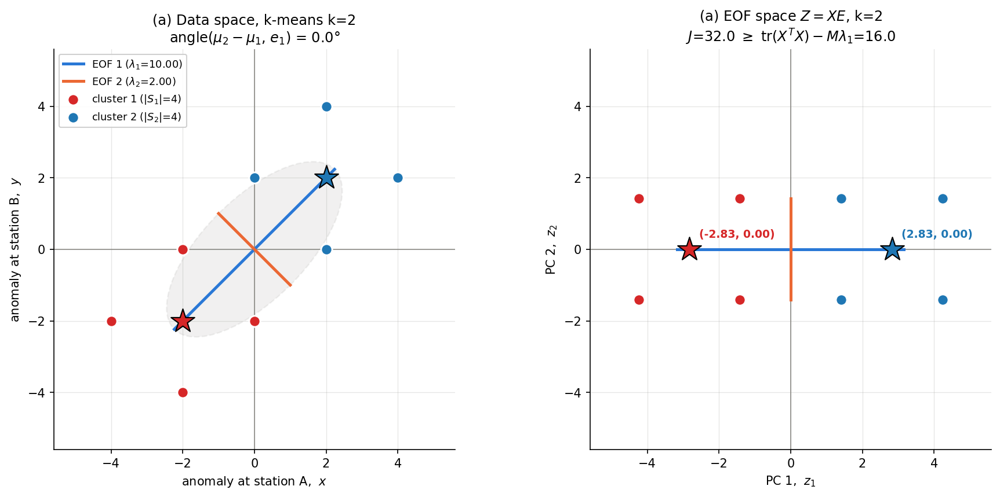
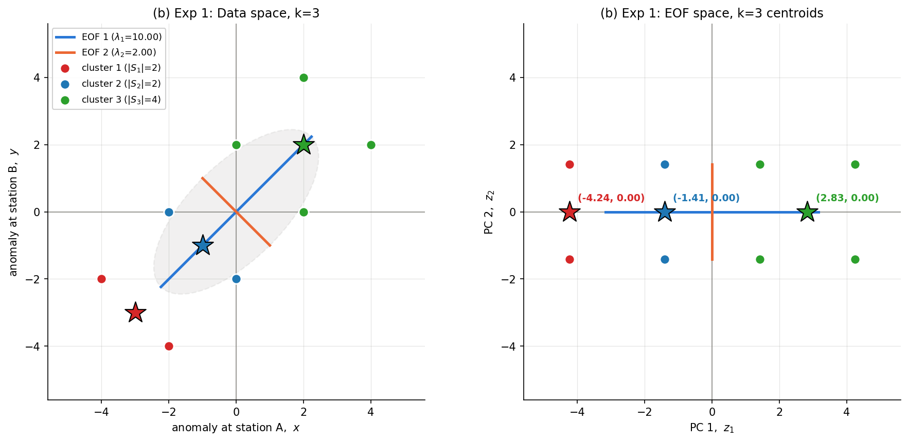
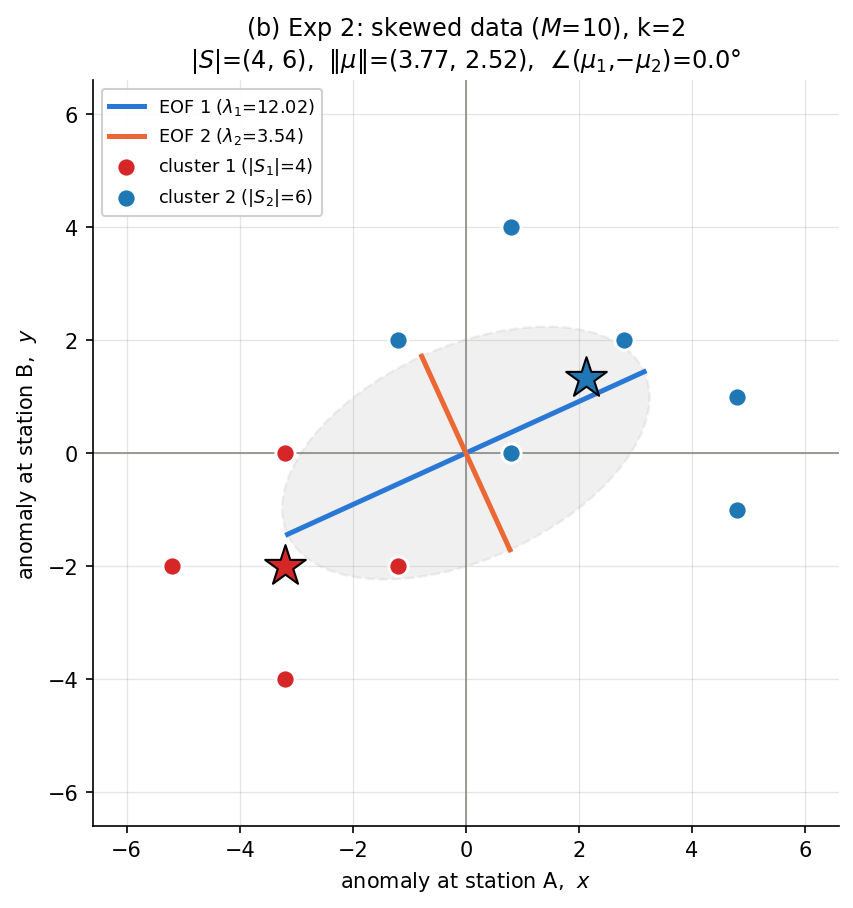
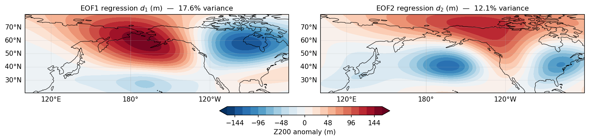
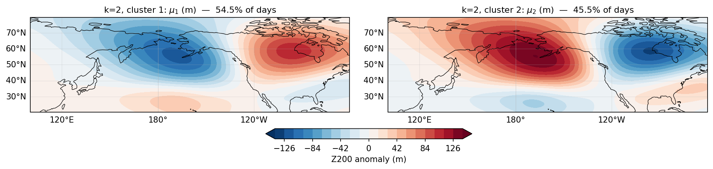
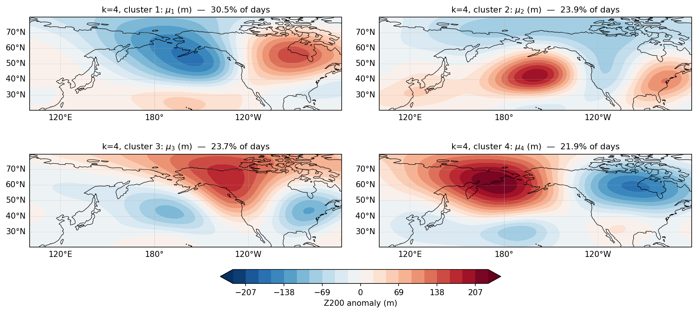
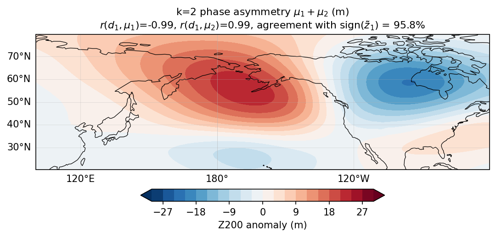
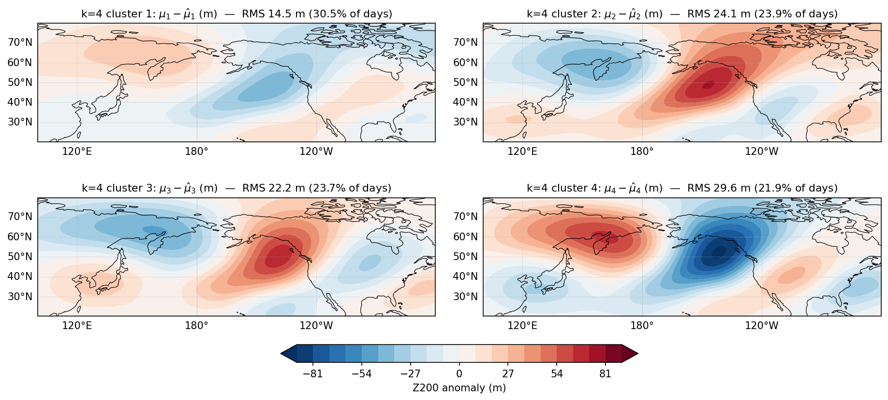

# Objective Analysis Week 10 Homework — 解答

題目見 [Week10.pdf](Week10.pdf)，中文翻譯與「題目在問什麼」的說明見 [hw10_question_zh.md](hw10_question_zh.md)。程式：(a)(b) 為 [hw10_q1ab.py](hw10_q1ab.py)，(c) 為 [hw10_q1c.py](hw10_q1c.py)。執行方式為 `py -X utf8 hw10_q1ab.py`，以及 `C:\Users\PDK\anaconda3\python.exe -X utf8 hw10_q1c.py`。(c) 需要用 anaconda base 執行，因為只有它裝了 cartopy，地圖才會畫出海岸線；如果環境沒有 cartopy，程式仍然可以執行，只是地圖不會有海岸線。(c) 的完整數值輸出存在 [q1c_output.txt](q1c_output.txt)。

---

## (a) 幾何與數值驗證（$M=8,\ N=2,\ k=2$）

資料與講義 `eof_scatter_2d.py` 相同。$C=\frac1M X^TX=\begin{pmatrix}6&4\\4&6\end{pmatrix}$，所以 $\lambda_1=10,\ \lambda_2=2$，且 $e_1=(1,1)/\sqrt2,\ e_2=(1,-1)/\sqrt2$。k-means 使用 `n_init=50, random_state=0`。

### Centroid 方向

$$
\mu_1=(-2,-2),\qquad \mu_2=(2,2)
$$

在 EOF 空間中，兩個 centroid 為 $(z_1,z_2)=(\mp2.828,\ 0)$，因此兩者都落在 EOF1 軸上。$\mu_2-\mu_1=(4,4)$ 與 $e_1$ 的夾角為 **0°**。

### 分群標籤與 PC1 符號的比較

| $t$ | $(x,y)$ | $z_1$ | $z_2$ | sign$(z_1)$ | cluster |
|---|---|---|---|---|---|
| 1 | (−4,−2) | −4.243 | −1.414 | − | 1 |
| 2 | (−2,−4) | −4.243 | +1.414 | − | 1 |
| 3 | (−2, 0) | −1.414 | −1.414 | − | 1 |
| 4 | ( 0,−2) | −1.414 | +1.414 | − | 1 |
| 5 | ( 0, 2) | +1.414 | −1.414 | + | 2 |
| 6 | ( 2, 0) | +1.414 | +1.414 | + | 2 |
| 7 | ( 2, 4) | +4.243 | −1.414 | + | 2 |
| 8 | ( 4, 2) | +4.243 | +1.414 | + | 2 |

所有 8 個觀測的分群結果都與 sign$(z_1)$ 一致（一致率 100%）。換句話說，k=2 的 k-means 就是以 EOF1 的零線（也就是 EOF2 軸）把資料切成兩半。

### 成本函數下界

$$
J=\sum_{i=1}^{2}\sum_{x\in S_i}\|x-\mu_i\|^2=32,\qquad
\operatorname{tr}(X^TX)-M\lambda_1=96-80=16
$$

因此 $J=32\ge16$，不等式成立。我也窮舉了全部 127 種 2-分割，最小的 $J$ 正是 32，所以 k-means 找到的是全域最佳解，而這個下界本身無法達到。

**差距 16 的來源**：在 EOF 座標中，$J$ 可以拆成兩個方向的貢獻。

* $z_2$ 方向：兩個 centroid 的 $z_2$ 都是 0，所以每個點貢獻 $z_2^2=2$，共 $16=M\lambda_2$。這部分正是下界 $\operatorname{tr}(X^TX)-M\lambda_1=M\lambda_2$。
* $z_1$ 方向：每群內部的 $z_1$ 是 $\{\pm4.243,\pm1.414\}$ 繞著 $\pm2.828$ 分佈，偏差都是 $\pm1.414$，共 $8\times2=16$。

Ding & He 的連續鬆弛允許「指標向量」取連續值，於是可以取成 PC1 本身，把 $z_1$ 方向的變異完全解釋掉；但實際的分群指標只能取離散值，同一群內的點必須共用同一個 $z_1$，所以多出了群內 $z_1$ 的變異 16。

---

## (b) k-means 與 EOF 的分歧

### Experiment 1：$k=3$

`random_state=0` 得到的結果：

| cluster | 成員 | $\mu$ | $(z_1,z_2)$ |
|---|---|---|---|
| 1 | {1,2} | (−3,−3) | (−4.243, 0) |
| 2 | {3,4} | (−1,−1) | (−1.414, 0) |
| 3 | {5,6,7,8} | (2,2) | (2.828, 0) |

這組解的三個 centroid 都嚴格落在 EOF1 軸上（$\max|z_2|=0$）。$J=24$。

**但是這個答案不是唯一的。** 我窮舉了全部 3-分割，發現有 **5 種分割同時達到全域最小值 $J=24$**：

| 分割 | centroids $(z_1,z_2)$ | 是否全在 EOF1 軸上 |
|---|---|---|
| {1,2,3,4}, {5,6}, {7,8} | (−2.83,0), (1.41,0), (4.24,0) | 是 |
| {1,2}, {3,4,5,6}, {7,8} | (−4.24,0), (0,0), (4.24,0) | 是 |
| {1,2}, {3,4}, {5,6,7,8} | (−4.24,0), (−1.41,0), (2.83,0) | 是 |
| {1,2,3,4}, {5,7}, {6,8} | (−2.83,0), (2.83,**−1.41**), (2.83,**+1.41**) | **否，沿 EOF2 分裂** |
| {1,3}, {2,4}, {5,6,7,8} | (−2.83,**−1.41**), (−2.83,**+1.41**), (2.83,0) | **否，沿 EOF2 分裂** |

換不同的 seed（0–29），sklearn 會落在其中 4 種解上，其中有 8/30 次得到沿 EOF2 分裂的解。

**解讀**：

* 當 $k=2$ 時，k-means 只用到 EOF1 方向，這與 Ding–He 的結論一致：$k$ 群的連續鬆弛解由前 $k-1$ 個 PC 張成。
* 當 $k=3$ 時，連續鬆弛允許 centroid 張成前 $k-1=2$ 個 EOF 的平面，所以第三群「可以」沿 EOF2 分裂。在這份資料中，「沿 EOF1 再切一刀」與「在一半資料裡沿 EOF2 切一刀」恰好都讓 $J$ 減少 8（從 32 到 24），所以兩種情況並存。
* 因此，第三個 centroid 不一定落在 EOF1 軸上。沿 EOF2 分裂的解中，$z_2\neq0$ 只出現在一半的資料（$z_1>0$ 或 $z_1<0$ 那側）；這種「只在某一個相位才出現的結構」無法用一組全域正交的 EOF 線性組合表示，正是 k-means 與 EOF 分歧的地方。
* 這份 toy data 的對稱性很高，所以出現了退化（多重最佳解）。真實資料一般不會剛好退化，但同樣的機制會讓 $k\ge3$ 的 centroid 離開 EOF1 軸。

### Experiment 2：不對稱極端值

加入 $(6,-1)$ 與 $(6,1)$ 後，新的欄平均是 $(1.2,\ 0)$；扣除欄平均後得到 $X_{\rm skew}$（$M=10$）。

$$
C_{\rm skew}=\begin{pmatrix}10.56&3.2\\3.2&5.0\end{pmatrix},\quad
\lambda=(12.02,\ 3.54),\quad
e_1=(0.910,\ 0.415)
$$

$e_1$ 與 $x$ 軸的夾角從 45° 變成 24.5°，因為兩個極端點都在 $x$ 方向。

k=2 的分群結果為 $S_1=\{1,2,3,4\}$ 與 $S_2=\{5,\dots,10\}$，並且

$$
\mu_1=(-3.2,\ -2.0),\qquad \mu_2=(2.133,\ 1.333)
$$

| 量 | 原始資料 ($M=8$) | 不對稱資料 ($M=10$) |
|---|---|---|
| $(\lvert S_1\rvert,\lvert S_2\rvert)$ | (4, 4) | (4, 6) |
| $(\lVert\mu_1\rVert,\lVert\mu_2\rVert)$ | (2.828, 2.828) | (3.774, 2.516) |
| $\angle(\mu_1,-\mu_2)$ | 0° | **0°** |
| $\angle(\mu_2-\mu_1,\ e_1)$（補充） | 0° | 7.5° |

**為什麼 $\mu_1$ 與 $-\mu_2$ 的夾角一定是 0°？** 因為 $X$ 的每一欄平均都是 0，所以

$$
\sum_{t}x_t=0\ \Rightarrow\ |S_1|\mu_1+|S_2|\mu_2=0\ \Rightarrow\ \mu_1=-\frac{|S_2|}{|S_1|}\,\mu_2
$$

所以對 $k=2$ 而言，兩個 centroid 永遠位在同一條通過原點的直線上、方向相反。不對稱性不會出現在「方向」，而是出現在：

1. **長度不同**：$\lVert\mu_1\rVert/\lVert\mu_2\rVert=|S_2|/|S_1|=6/4=1.5$。數值上 $3.774/2.516=1.500$，與上式相符。少數、強烈的那一群（cluster 1）振幅較大，多數、溫和的那一群振幅較小。單一 EOF 模態的正負相位只能是 $\pm d_1$，振幅一定相同，無法表示這種差異。
2. **頻率不同**：$|S_1|\neq|S_2|$（40% vs 60%）。EOF 的 PC 只提供連續的振幅，沒有「出現頻率」的概念。
3. **方向偏離 $e_1$**：centroid 連線 $\mu_2-\mu_1$ 與 $e_1$ 夾 7.5°。$e_1$ 最大化的是總變異，因此被兩個極端點拉向 $x$ 軸；k-means 最小化的是群內離散，兩者的目標在不對稱資料中不再一致。

---

## (c) ERA5 DJF $Z_{200}$ 距平

### 資料準備

* $M=3881$ 天（1979–2021 DJF），網格為 $120\times320$（20.25–79.75°N、100.3–299.7°E，0.5°×0.625°），所以 $N=38{,}400$，單位是 m。
* 在每個格點扣除時間平均，確保 $X$ 的每一欄平均為 0（扣除後 $\max|\bar X_{:,n}|\approx2\times10^{-5}$ m）。
* 加權：$X_w=X\cdot\sqrt{\cos\theta}$。為了節省記憶體，程式只保存 $X_w$ 一份；需要未加權的量時，逐格點除以 $\sqrt{\cos\theta}$ 還原。

### EOF 分析

因為 $N\gg M$，程式不形成 $N\times N$ 的 $C$，而是對 $M\times M$ 的 Gram 矩陣 $G=X_wX_w^T$ 做特徵分解：

$$
G\,u_j=\sigma_j^2u_j,\qquad
e_j=\frac{X_w^Tu_j}{\sigma_j},\qquad
\lambda_j=\frac{\sigma_j^2}{M},\qquad
z_j=X_we_j=\sigma_ju_j
$$

這樣 $C e_j=\frac1M X_w^TX_w\frac{X_w^Tu_j}{\sigma_j}=\frac1M X_w^T\frac{G u_j}{\sigma_j}=\frac{\sigma_j^2}{M}e_j$，與直接分解 $C$ 的結果相同。數值檢查：$E^TE=I$，且 $\mathrm{var}(z_j)=\lambda_j$ 到機器精度。

接著把 $z_j$ 標準化成 $\tilde z_j$，並計算 $d_j=\frac1M\tilde z_j^TX$（使用未加權的 $X$）。

前 5 個模態的解釋變異：17.6%、12.1%、9.3%、8.1%、5.9%。

* **EOF1（17.6%）**：阿留申／北太平洋（約 190°E、57°N）與加拿大（約 265°E、58°N）呈反相，副熱帶中太平洋還有一個較弱的中心，是 PNA 型的波列。
* **EOF2（12.1%）**：高緯（阿拉斯加—北極，約 220°E、70°N）與中緯度兩個中心（約 195°E、40°N 和 280°E、42°N）呈反相，是南北向的偶極（類似 WP／NPO 的結構）。

（因為 EOF 的符號是任意的，程式把每個 $d_j$ 的最大絕對值處定為正號。）

### k-means（在 $X_w$ 上，`n_init=20, random_state=0`）

Cluster 依出現頻率由高到低編號。地圖上畫的是未加權的 composite，也就是 centroid 除以 $\sqrt{\cos\theta}$。

| | cluster 1 | cluster 2 | cluster 3 | cluster 4 |
|---|---|---|---|---|
| $k=2$：$\lvert S_i\rvert$（頻率） | 2115（54.5%） | 1766（45.5%） | | |
| $k=4$：$\lvert S_i\rvert$（頻率） | 1184（30.5%） | 928（23.9%） | 918（23.7%） | 851（21.9%） |

* $k=2$：$\mu_1\approx-d_1$（北太平洋槽、加拿大脊），$\mu_2\approx+d_1$（北太平洋脊、加拿大槽）。
* $k=4$：cluster 1 與 4 分別是 EOF1 的負相位與正相位，cluster 2 與 3 分別是 EOF2 的負相位與正相位。但這四個 regime 並不是 EOF 的嚴格正負號，細節見下方的比較 (b)。

### 比較 (a)：相位不對稱（$k=2$）

| 量 | 數值 |
|---|---|
| $r(d_1,\mu_1)$ | −0.990 |
| $r(d_1,\mu_2)$ | +0.990 |
| $r(d_2,\mu_1),\ r(d_2,\mu_2)$ | +0.132, −0.132 |
| $k=2$ 標籤與 sign$(\tilde z_1)$ 的時間一致率 | **95.8%** |
| 面積加權 RMS：$\mu_1$ / $\mu_2$ / $\mu_1+\mu_2$ | 45.1 m / 54.0 m / 8.9 m |
| $\max\lvert\mu_1+\mu_2\rvert$ | 23.1 m |

（Pattern correlation 使用 $\cos\theta$ 面積權重，並先扣除面積加權的空間平均。）

**結果解讀**：

1. $k=2$ 的 k-means 幾乎就是 EOF1 的正負號：pattern correlation 達 ±0.99，且 95.8% 的日子分群與 sign$(\tilde z_1)$ 相同。剩下 4.2% 的不一致，來自 k-means 的分界面並不完全等於 $\tilde z_1=0$：分界面還受到 EOF2 與更高階模態的影響（$r(d_2,\mu_i)=\pm0.13$）。這呼應了 (a) 中 Ding–He 的結論。
2. $\mu_1+\mu_2\neq0$：最大達 23 m，形狀與 $\mu_2$（PNA 正相位：北太平洋脊、加拿大槽）相同。這代表**北太平洋阻塞脊相位比槽相位更強**（RMS 54.0 vs 45.1 m），但出現頻率較低（45.5% vs 54.5%）。單一 EOF 模態的正負相位只能是 $\pm d_1$，振幅必定相同，所以無法表示這種「強而少」與「弱而多」的不對稱。
3. **需要注意的限制**：和 (b) Exp 2 相同，$X$ 的欄平均為 0 會推出 $|S_1|\mu_1+|S_2|\mu_2=0$，因此

   $$
   \mu_1+\mu_2=\Bigl(1-\frac{|S_2|}{|S_1|}\Bigr)\mu_1=0.165\,\mu_2
   $$

   數值上 $r(\mu_1,-\mu_2)=1.0000$，而且 $8.9/54.0=0.165$，與上式相符。所以 $k=2$ 的 $\mu_1+\mu_2$ 圖只能顯示「振幅與頻率」的不對稱，形狀上必然與 $\mu_2$ 相同；它無法顯示「兩個相位空間型態不同」的那種不對稱。要看到型態上的不對稱，需要 $k\ge3$，也就是下面的比較 (b)。

### 比較 (b)：線性 EOF 殘差（$k=4$）

$\hat\mu_{i,w}=\sum_{j=1}^2(\mu_{i,w}\cdot e_j)e_j$，接著除以 $\sqrt{\cos\theta}$ 得到 $\hat\mu_i$（m）。

| cluster | 頻率 | $(\mu_{i,w}\cdot e_1,\ \mu_{i,w}\cdot e_2)$ | RMS $\mu_i$ | RMS $(\mu_i-\hat\mu_i)$ | 前兩個 EOF 解釋的比例 | $r(\mu_i,\hat\mu_i)$ |
|---|---|---|---|---|---|---|
| 1 | 30.5% | (−9777, −350) | 65.3 m | 14.5 m | 95.1% | 0.976 |
| 2 | 23.9% | (1723, −8215) | 59.7 m | 24.1 m | 83.8% | 0.920 |
| 3 | 23.7% | (384, 8269) | 58.3 m | 22.2 m | 85.5% | 0.926 |
| 4 | 21.9% | (11310, 526) | 79.5 m | 29.6 m | 86.1% | 0.932 |

（「前兩個 EOF 解釋的比例」定義為 $1-\sum\cos\theta\,(\mu_i-\hat\mu_i)^2/\sum\cos\theta\,\mu_i^2$。）

**4×4 pattern correlation $r(\mu_i,\mu_j)$**：

| | $\mu_1$ | $\mu_2$ | $\mu_3$ | $\mu_4$ |
|---|---|---|---|---|
| $\mu_1$ | 1.000 | −0.213 | −0.153 | **−0.837** |
| $\mu_2$ | −0.213 | 1.000 | **−0.698** | −0.012 |
| $\mu_3$ | −0.153 | −0.698 | 1.000 | −0.057 |
| $\mu_4$ | −0.837 | −0.012 | −0.057 | 1.000 |

**結果解讀**：

1. **正負相位並非彼此的鏡像**：若 regime 只是 $\pm$EOF，則應有 $r(\mu_1,\mu_4)=r(\mu_2,\mu_3)=-1$。實際值只有 −0.84 與 −0.70，所以同一個 EOF 的兩個相位在空間型態上確實不同。
2. **EOF1 正相位（cluster 4）**：振幅最大（RMS 79.5 m）且頻率最低（21.9%），殘差也最大（29.6 m）。殘差圖在 150–175°E 為正、在 210–230°E 為負，表示這個 regime 的阻塞脊比 $d_1$ 偏西、偏北，下游的槽則延伸到阿拉斯加灣。負相位（cluster 1）最常出現（30.5%），殘差最小（14.5 m，前兩個 EOF 解釋 95%），所以這個相位與線性 EOF 最接近。這與比較 (a) 的「脊相位強而少」一致，而且更進一步顯示脊相位的位置也不同。
3. **EOF2 的兩個相位（cluster 2、3）**：兩者的殘差都在阿拉斯加灣／北美西岸（約 215–225°E、50°N）出現 **同號的正值**。這個共同的成分無法由 $\pm d_2$ 表示，必須來自更高階的 EOF；而且 cluster 2 在 $e_1$ 上也有不可忽略的投影（1723）。換句話說，這兩個 regime 是 EOF1、EOF2 與高階模態的非線性組合，而不是單一模態的正負號。
4. **非正交性**：EOF 彼此正交（$e_i\cdot e_j=\delta_{ij}$），但 regime 之間的非對角相關不為零，例如 $r(\mu_1,\mu_2)=-0.21$、$r(\mu_1,\mu_3)=-0.15$。這反映 k-means 只要求每一天被分到最近的 centroid，並沒有要求 centroid 彼此正交，因此它能用少數幾個「離散、可重複出現」的型態描述大氣，代價是失去 EOF 的線性可疊加性。

### 小結

| | EOF | k-means |
|---|---|---|
| 目標 | 最大化投影變異 | 最小化群內離散 $J$ |
| 型態 | 正交、可線性疊加 | 不正交、離散 regime |
| 正負相位 | 必定對稱（$\pm d_j$） | 振幅、頻率、位置都可以不同 |
| 與另一方的關係 | $k$ 群的連續鬆弛解由前 $k-1$ 個 PC 張成 | $k=2$ 時 ≈ sign(PC1)（ERA5 一致率 95.8%） |
