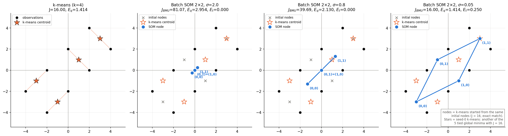
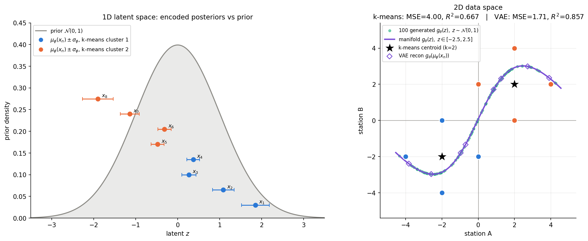

# Objective Analysis Week 11 Homework — 解答

題目見 [Week11.pdf](Week11.pdf)，中文翻譯與「題目在問什麼」的說明見 [hw11_question_zh.md](hw11_question_zh.md)。

程式：(a)(b) 為 [hw11_q1ab.py](hw11_q1ab.py)，(c) 為 [hw11_q1c.py](hw11_q1c.py)，VAE 實作在 [vae_numpy.py](vae_numpy.py)。執行方式為 `py -X utf8 hw11_q1ab.py` 與 `py -X utf8 hw11_q1c.py`；完整的數值輸出存在 [q1ab_output.txt](q1ab_output.txt) 與 [q1c_output.txt](q1c_output.txt)。

**關於 VAE 的實作**：本機沒有安裝 PyTorch，所以我用 numpy 手寫了一個 VAE（encoder 與 decoder 各一層 tanh 隱藏層，加上 reparameterization trick 與 Adam）。反向傳播是手推的，我用中央差分檢查過梯度，最大相對誤差為 $4\times10^{-9}$（執行 `py vae_numpy.py` 可重現）。損失函數與題目的定義完全相同：

$$
L=\frac{1}{2\sigma_x^2B}\sum_{n}\|x_n-\hat x_n\|^2+\frac{1}{2B}\sum_n\sum_j\bigl(\mu_{n,j}^2+\sigma_{n,j}^2-\ln\sigma_{n,j}^2-1\bigr),
$$

其中 $B$ 是 batch 大小（(b) 使用 full batch，所以 $B=M$）。

---

## (a) k-means vs. Batch SOM

資料是 `eof_scatter_2d.py` 的 8 個點，$\operatorname{tr}(X^TX)=96$。

### 基準 k-means（$k=4$，`n_init=50, random_state=0`）

| cluster | 成員 | $\mu_i$ |
|---|---|---|
| 1 | $x_1=(-4,-2),\ x_3=(-2,0)$ | $(-3,-1)$ |
| 2 | $x_2=(-2,-4),\ x_4=(0,-2)$ | $(-1,-3)$ |
| 3 | $x_5=(0,2),\ x_6=(2,0)$ | $(1,1)$ |
| 4 | $x_7=(2,4),\ x_8=(4,2)$ | $(3,3)$ |

$$
J=16.000,\qquad E_q=\frac1M\sum_n\|x_n-\mu_{c(n)}\|=\sqrt2=1.414
$$

每一群都是兩個相距 $2\sqrt2$ 的點，所以每個點到 centroid 的距離都是 $\sqrt2$，每群貢獻 $2\times2=4$，總和 $J=16$。

**全域最佳解不唯一。** 我窮舉了全部 1701 種 4-分割，有 **5 種分割同時達到全域最小值 $J=16$**：

| 分割 | 說明 |
|---|---|
| {1,2}, {3,4}, {5,6}, {7,8} | 全部沿 EOF1 排列：centroid 為 $(-3,-3),(-1,-1),(1,1),(3,3)$ |
| {1,2}, {3,4}, {5,7}, {6,8} | 右上半部改成沿 EOF2 分裂 |
| {1,2}, **{3,5}, {4,6}**, {7,8} | 中間兩群沿 EOF2 分裂：centroid 為 $(-3,-3),(-1,1),(1,-1),(3,3)$ |
| {1,3}, {2,4}, {5,6}, {7,8} | 左下半部沿 EOF2 分裂（seed 0 得到的解） |
| {1,3}, {2,4}, {5,7}, {6,8} | 兩半部都沿 EOF2 分裂 |

原因是這份資料由 4 對「相距 $2\sqrt2$」的點組成，而且有很高的對稱性，所以很多種兩兩配對的方式都會讓每一群貢獻相同的 4。

### Batch SOM（2×2，初始節點 $(-3,-3),(-1,1),(1,-1),(3,3)$）

每次迭代先找 BMU，再用 $n_j\leftarrow\sum_nh_{c(n)j}x_n/\sum_nh_{c(n)j}$ 更新，直到節點變化小於 $10^{-12}$。2×2 格子上，相鄰節點的 $\|g_i-g_j\|^2=1$，對角節點為 2。

| $\sigma$ | $h$（相鄰） | $h$（對角） | 收斂後節點 $n_{(0,0)},\ n_{(0,1)},\ n_{(1,0)},\ n_{(1,1)}$ |
|---|---|---|---|
| 2.0 | 0.883 | 0.779 | $(-0.249,-0.249)$, $(0,0)$, $(0,0)$, $(0.249,0.249)$ |
| 0.8 | 0.458 | 0.210 | $(-1.307,-1.307)$, $(0,0)$, $(0,0)$, $(1.307,1.307)$ |
| 0.05 | $\approx e^{-200}$ | $\approx e^{-400}$ | $(-3,-3)$, $(-1,1)$, $(1,-1)$, $(3,3)$ |

### 摘要表

| 方法 | $J_{\rm BMU}$ | $E_q$ | $E_t$ |
|---|---|---|---|
| k-means ($k=4$) | **16.000** | **1.414** | — |
| SOM, $\sigma=2.0$ | 81.073 | 2.954 | 0.000 |
| SOM, $\sigma=0.8$ | 39.687 | 2.130 | 0.000 |
| SOM, $\sigma=0.05$ | **16.000** | **1.414** | **0.250** |

（k-means 的 centroid 沒有排在格子上，所以 $E_t$ 沒有定義。）

### 結果解讀

**1. $\sigma$ 大時，節點收縮到資料中心。** 當 $\sigma=2.0$ 時，相鄰與對角節點的鄰域權重都接近 1（0.88 與 0.78），所以每個節點的更新幾乎都是「全部資料的平均」，而全部資料的平均就是原點。結果四個節點都擠在原點附近（最遠的只離原點 0.35），$J_{\rm BMU}=81$ 只比「全部用原點代表」的 96 好一點點。收斂後，只有 $n_{(0,0)}$ 與 $n_{(1,1)}$ 會被選為 BMU（左下 4 點與右上 4 點），$n_{(0,1)}$ 與 $n_{(1,0)}$ 沒有任何資料，它們的位置完全由鄰居決定：它們與 $n_{(0,0)}$、$n_{(1,1)}$ 的權重相同，於是被拉到兩者的正中間，也就是原點。

**2. $\sigma=0.8$ 時，地圖退化成一條線。** 鄰域權重降到 0.46（相鄰）與 0.21（對角），節點能伸展得比較開（$\pm1.307$），$J_{\rm BMU}$ 降到 39.7。但兩個沒有資料的節點仍然重疊在原點，所以這張 2×2 地圖實際上只用到兩個節點，也就是 $k=2$ 的分群：BMU 的分法與 $k=2$ 的 k-means 完全相同，都是左下 4 點與右上 4 點。不過節點位置是 $\pm1.307(1,1)$，而不是 k-means 的 $\pm2(1,1)$，因為每個節點的更新都被另一側的資料（透過對角權重 0.21）和原點的空節點往內拉。

這兩個例子的 $E_t=0$，原因是唯一被使用的兩個節點 $(0,0)$ 與 $(1,1)$，它們的第二 BMU 都是原點上的 $(0,1)$ 或 $(1,0)$，而這兩個節點與 $(0,0)$、$(1,1)$ 都相鄰。換句話說，大 $\sigma$ 的地圖「拓撲很整齊」，但代價是重建誤差很大。

**3. $\sigma\to0$ 時，SOM 等於 k-means。** 當 $\sigma=0.05$ 時，$h_{ij}=\exp(-200)\approx10^{-87}$（相鄰），在浮點數中與 0 無法區分。因此鄰域矩陣就是單位矩陣，迭代公式變成

$$
n_j\leftarrow\frac{\sum_n\delta_{c(n)j}\,x_n}{\sum_n\delta_{c(n)j}}=\frac{1}{|S_j|}\sum_{x_n\in S_j}x_n,
$$

這正是 k-means 的 Lloyd 更新，而目標函數 $E$ 也退化成 $J$。數值驗證如下：

* SOM 一步就收斂到 $(-3,-3),(-1,1),(1,-1),(3,3)$，$J_{\rm BMU}=16.000$，$E_q=1.414$，與 k-means 完全相同。
* 我用 sklearn 的 k-means、以同一組初始節點（`init=NODE0, n_init=1`）執行，得到的 centroid 與 SOM 節點的最大差值為 **0**（完全一致）。
* 這組解是上表 5 個全域最佳解中的第 3 個。seed 0 的 k-means 停在另一個同樣是 $J=16$ 的解（第 4 個），所以圖中第 4 格的星號與 SOM 節點位置不同；這是最佳解退化造成的，不是 SOM 沒有收斂到 k-means。

**4. 代價：拓撲誤差不為零。** 沒有鄰域約束時，節點只追求重建誤差最小，不在乎格子上誰跟誰相鄰。在 $\sigma=0.05$ 的解中，格子上「不相鄰」的 $(0,1)$ 與 $(1,0)$ 被放在 $(-1,1)$ 與 $(1,-1)$，兩者都在資料中間，因此很多點的第一、第二 BMU 剛好是這對在格子上的對角節點。

以 $x_5=(0,2)$ 為例：它的 BMU 是 $n_{(0,1)}=(-1,1)$（距離平方 2）；第二近的節點有兩個平手，$n_{(1,0)}=(1,-1)$ 與 $n_{(1,1)}=(3,3)$ 的距離平方都是 10。若取前者，$\|g_{(0,1)}-g_{(1,0)}\|_1=2>1$，就算一次拓撲錯誤。

$x_3,x_4,x_5,x_6$ 四個點都有這種平手。程式在平手時取編號較小的節點，結果 $x_5,x_6$ 算錯、$x_3,x_4$ 不算錯，所以 $E_t=2/8=0.25$。依照平手的取法，$E_t$ 可以介於 0 到 0.5 之間；如果平手時隨機選擇，期望值剛好也是 $4\times\frac12/8=0.25$。平手是這份 toy data 對稱性太高的結果，但「$\sigma\to0$ 時拓撲約束消失，$E_t$ 可能不為零」這個結論是一般性的。

**總結**：$\sigma$ 是在「重建誤差」（$J_{\rm BMU},E_q$）與「拓撲保持」（$E_t$）之間的旋鈕。$\sigma$ 越大，地圖越平滑、拓撲越整齊，但節點往資料中心收縮，重建誤差變大；$\sigma\to0$ 時重建誤差降到 k-means 的最佳值，但格子的鄰居關係不再有意義，SOM 就只是一個節點恰好排在格子上的 k-means。

---

## (b) k-means vs. VAE

### 離散基準：k-means（$k=2$，`n_init=50, random_state=0`）

$\mu_1=(-2,-2)$（成員 $x_1$–$x_4$），$\mu_2=(2,2)$（成員 $x_5$–$x_8$），與 hw10 的結果相同。

### VAE（latent 維度 1）

架構為 2 → 16 tanh → $(\mu_\phi,\ln\sigma_\phi^2)$，以及 1 → 16 tanh → 2；$\sigma_x^2=0.5$，Adam 的學習率為 0.01，full batch，2000 個 epoch，seed 0。

| $n$ | $x_n$ | $\mu_\phi(x_n)$ | $\sigma_\phi(x_n)$ | $\hat x_n=g_\theta(\mu_\phi)$ | k-means cluster |
|---|---|---|---|---|---|
| 1 | (−4,−2) | +1.851 | 0.329 | (−3.820, −2.391) | 1 |
| 2 | (−2,−4) | +1.088 | 0.254 | (−2.588, −2.968) | 1 |
| 3 | (−2, 0) | +0.267 | 0.169 | (−0.698, −1.334) | 1 |
| 4 | ( 0,−2) | +0.371 | 0.153 | (−0.967, −1.795) | 1 |
| 5 | ( 0, 2) | −0.478 | 0.155 | (+1.263, +2.317) | 2 |
| 6 | ( 2, 0) | −0.315 | 0.161 | (+0.847, +1.716) | 2 |
| 7 | ( 2, 4) | −1.144 | 0.227 | (+2.720, +2.991) | 2 |
| 8 | ( 4, 2) | −1.902 | 0.367 | (+3.906, +2.352) | 2 |

最終的確定性重建項為 1.711，KL 項為 1.697（nats／樣本）。

### 摘要表

| 方法 | 自由度 | MSE | $R^2$ |
|---|---|---|---|
| k-means（$k=2$） | 2 個離散狀態 | 4.000 | 0.667 |
| VAE（$k=1$ latent） | 1 個連續座標 | **1.711** | **0.857** |
| （參考）EOF1 截斷 | 1 個連續座標（線性） | 2.000 | 0.833 |

k-means 的 $J=32$，所以 MSE $=32/8=4$，$R^2=1-32/96=2/3$。EOF1 截斷只留下 $\lambda_2$ 的變異，所以 MSE $=\lambda_2=2$，$R^2=\lambda_1/(\lambda_1+\lambda_2)=10/12$。

### 結果解讀

**1. latent 座標本質上就是 PC1。** $\mu_\phi(x_n)$ 與 PC1 $z_1=(x+y)/\sqrt2$ 的相關係數為 −0.966（latent 的正負號是任意的，這次剛好反向）。所以 encoder 學到的第一件事，就是沿著變異最大的方向排序資料。在左圖中，兩個 k-means 群在 $z$ 軸上完全分開：cluster 1 在 $z>0$，cluster 2 在 $z<0$，因此 k-means 的分群可以看成「把連續的 latent 座標在 $z=0$ 處切一刀」。

**2. VAE 的重建比 k-means 好得多，也比 EOF1 好一點。**

* k-means 只有 2 個狀態，同一群的 4 個點都被重建成同一個 centroid，所以群內沿 EOF1 的變異（16）與沿 EOF2 的變異（16）全部變成誤差。
* EOF1 截斷用一條直線，能保留每個點在 EOF1 上的位置，但 EOF2 方向的變異（$M\lambda_2=16$）全部損失。
* VAE 的 decoder 是非線性的，流形 $g_\theta(z)$ 是一條 **S 形曲線**（右圖紫線）：在原點附近它比 45° 線更陡，在兩端（$|z|$ 大時）則向回彎。這讓它可以同時抓到一部分 EOF2 方向的資訊，例如 $x_1=(-4,-2)$ 被重建成 $(-3.82,-2.39)$，比投影到 EOF1 軸上的 $(-3,-3)$ 更接近原值。因此 MSE 從 2.0 降到 1.71。

**3. VAE 不會把 8 個點完美記住，因為有 KL 項。** 如果只最小化重建誤差，一條足夠彎曲的曲線可以穿過全部 8 個點，讓 MSE 趨近 0。但 KL 項要求 posterior 接近 $\mathcal N(0,1)$：$\mu_\phi$ 不能離 0 太遠，$\sigma_\phi$ 也不能太小。這些 posterior 的寬度（0.15–0.37）意味著 decoder 必須在 $z$ 的小範圍內輸出相近的 $\hat x$，所以曲線必須平滑，無法為了單一點急轉彎。$\sigma_x^2=0.5$ 決定了這兩者的相對權重：$\sigma_x^2$ 越小，重建項越重要，曲線越貼近資料。

**4. VAE 是生成模型，k-means 不是。** 從先驗 $z\sim\mathcal N(0,1)$ 抽出 100 個樣本並解碼（右圖綠點），它們全部落在 S 形流形上，並且集中在中段（因為先驗在 $z=0$ 附近密度最大）。這些是資料中沒有出現過、但「看起來合理」的新狀態。k-means 只能輸出 2 個 centroid，不能產生新的狀態。

另一方面，這也顯示 VAE 的局限：生成的樣本只能落在一維曲線上，而原始資料在 EOF2 方向還有 $\pm\sqrt2$ 的散佈，所以生成分佈比真實分佈「更窄」。若要生成散佈，需要從 $p(x|z)=\mathcal N(g_\theta(z),\sigma_x^2I)$ 抽樣，也就是在曲線上加上變異數 0.5 的雜訊。

**5. 訓練尚未完全收斂。** 在 2000 個 epoch 時，損失仍在下降（見 [q1b_vae_loss.png](q1b_vae_loss.png)），所以這組數字取決於 seed 與 epoch 數。不過「VAE 的 MSE 明顯小於 k-means」這個結論不受影響。

---

## (c) ERA5 DJF $Z_{200}$ 距平

（待補）
