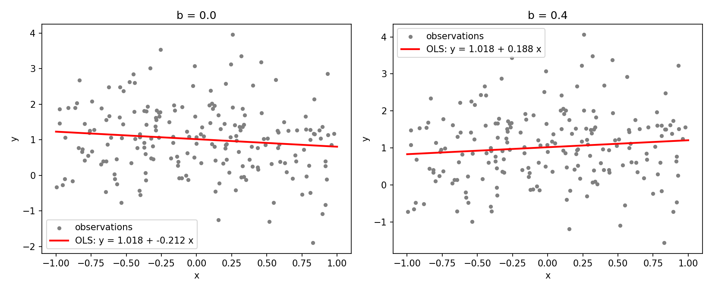
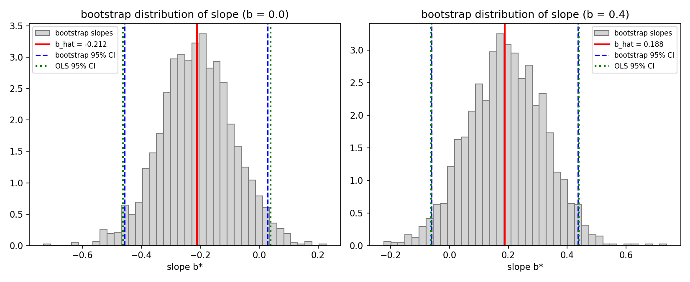
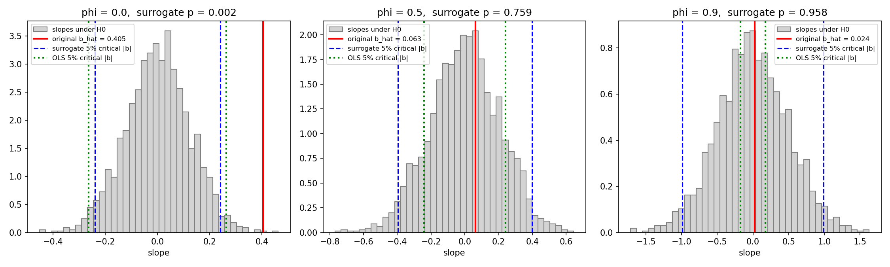
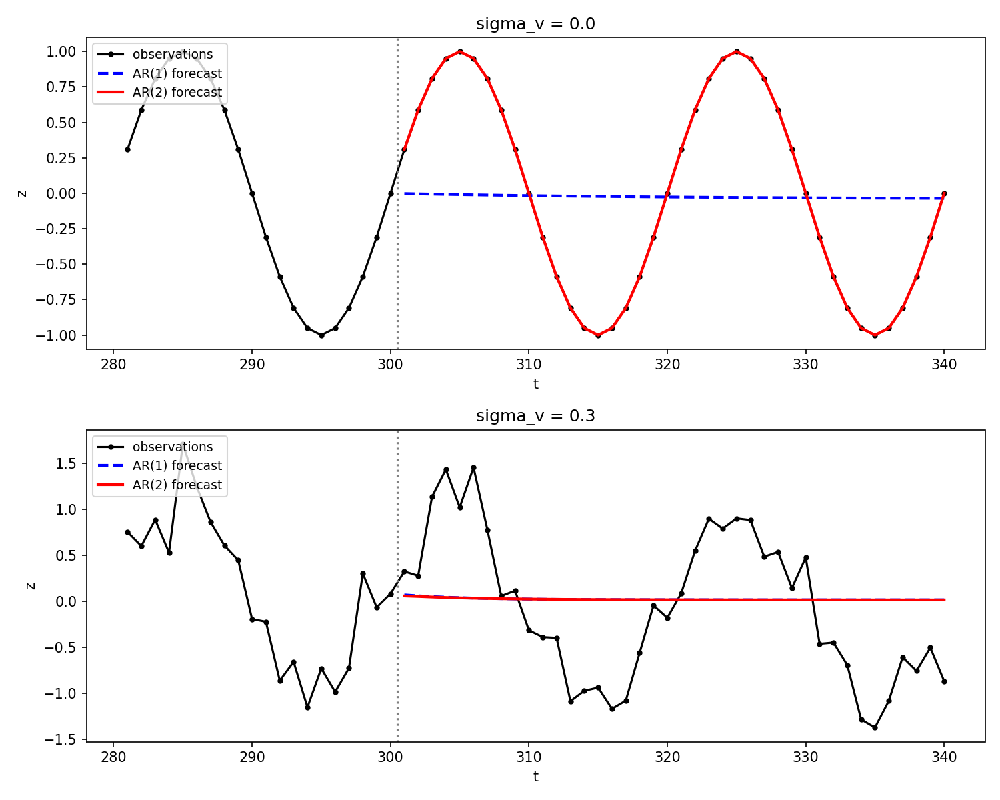

# Objective Analysis Week 05 Homework

## Question 1. Bootstrap Confidence Intervals for a Regression Slope

To investigate the uncertainty of a regression slope, generate $n = 200$ independent observations from

$$y_i = 1 + b x_i + \epsilon_i, \qquad x_i \sim U[-1, 1], \qquad \epsilon_i \sim \mathcal{N}(0, 1)$$

where $x_i$ and $\epsilon_i$ are independent. Consider two cases: $b = 0$ and $b = 0.4$. Here, $\mathcal{N}(\mu, \sigma^2)$ denotes a normal distribution with mean $\mu$ and variance $\sigma^2$. Use a fixed random seed and report it.

* (a) **Regression Estimation**
  * Estimate the intercept and slope using ordinary least squares (OLS).
  * Plot the observations and the fitted regression line for each value of $b$.
* (b) **Bootstrap Resampling**
  * Perform a pairs bootstrap with $B = 2000$ replicates. In each replicate, sample $n$ indices with replacement and select the corresponding pairs $(x_i, y_i)$ using the same indices.
  * Refit the regression for each bootstrap sample and retain the estimated slope $\hat b^{*(j)}$, where $j = 1, \dots, B$. Plot the bootstrap distribution of the estimated slope.
* (c) **Confidence Intervals**
  * Calculate the 95% percentile bootstrap confidence interval:

    $$\left[ q_{0.025}(\hat b^*),\ q_{0.975}(\hat b^*) \right]$$

    where $q_p$ denotes the empirical $p$-quantile. Compare this interval with the conventional 95% OLS confidence interval:

    $$\hat b \pm t_{0.975, n-2}\, \mathrm{SE}_{\mathrm{OLS}}(\hat b)$$
* (d) **Interpretation and Resampling Assumptions**
  * Explain why independently resampling the $x_i$ and $y_i$ values is inappropriate for this analysis.
  * Does the ordinary bootstrap slope distribution directly represent the null distribution under $H_0: b = 0$? Explain the distinction between estimating sampling uncertainty and constructing a null distribution.

### 中文翻譯

> **問題 1：迴歸斜率的 Bootstrap 信賴區間**
>
> 為了研究迴歸斜率的不確定性，由下式產生 $n = 200$ 筆獨立觀測：
>
> $$y_i = 1 + b x_i + \epsilon_i, \qquad x_i \sim U[-1, 1], \qquad \epsilon_i \sim \mathcal{N}(0, 1)$$
>
> 其中 $x_i$ 與 $\epsilon_i$ 彼此獨立。考慮兩種情況：$b = 0$ 與 $b = 0.4$。此處 $\mathcal{N}(\mu, \sigma^2)$ 表示平均為 $\mu$、變異數為 $\sigma^2$ 的常態分布。請使用固定的亂數種子並回報其數值。
>
> * (a) **迴歸估計**
>   * 以普通最小平方法（OLS）估計截距與斜率。
>   * 對每一個 $b$ 值，畫出觀測資料與擬合的迴歸直線。
> * (b) **Bootstrap 重抽樣**
>   * 進行 $B = 2000$ 次的成對 bootstrap（pairs bootstrap）。每次重抽時，有放回地抽出 $n$ 個索引，並用同一組索引選出對應的資料對 $(x_i, y_i)$。
>   * 對每一組 bootstrap 樣本重新擬合迴歸，保留估計的斜率 $\hat b^{*(j)}$，$j = 1, \dots, B$。畫出估計斜率的 bootstrap 分布。
> * (c) **信賴區間**
>   * 計算 95% 百分位數 bootstrap 信賴區間 $\left[ q_{0.025}(\hat b^*),\ q_{0.975}(\hat b^*) \right]$，其中 $q_p$ 表示經驗 $p$ 分位數。將此區間與傳統的 95% OLS 信賴區間 $\hat b \pm t_{0.975, n-2}\, \mathrm{SE}_{\mathrm{OLS}}(\hat b)$ 比較。
> * (d) **解讀與重抽樣假設**
>   * 解釋為什麼在本分析中，將 $x_i$ 與 $y_i$ 各自獨立地重抽是不恰當的。
>   * 一般的 bootstrap 斜率分布是否直接代表 $H_0: b = 0$ 下的虛無分布？說明「估計抽樣不確定性」與「建構虛無分布」之間的差別。

## Answer 1.

程式：[hw5_q1.py](hw5_q1.py)（執行：在 hw5 資料夾輸入 `py hw5_q1.py`）

### 基本知識

**1. OLS 斜率與標準誤**

$$\hat b = \frac{\sum_i (x_i - \overline{x})(y_i - \overline{y})}{\sum_i (x_i - \overline{x})^2} = \frac{S_{xy}}{S_{xx}}, \qquad \hat a = \overline{y} - \hat b\,\overline{x}$$

$$\hat\sigma^2 = \frac{1}{n-2}\sum_i (y_i - \hat a - \hat b x_i)^2, \qquad \mathrm{SE}_{\mathrm{OLS}}(\hat b) = \sqrt{\frac{\hat\sigma^2}{S_{xx}}}$$

殘差變異數除以 $n-2$，因為估計了 $a$、$b$ 兩個參數，用掉 2 個自由度；所以信賴區間用 $t_{n-2}$ 分布。

**2. Bootstrap 的想法**

我們只有一組樣本，無法重做實驗。Bootstrap 把「手上這組樣本」當成母體，從中有放回地重抽 $n$ 筆，模擬「再做一次實驗」。重複 $B$ 次，$\hat b^*$ 的分布就近似 $\hat b$ 的抽樣分布：

$$\hat b^* - \hat b \;\approx\; \hat b - b \quad (\text{分布上近似})$$

**3. 百分位數信賴區間**

把 $B$ 個 $\hat b^*$ 排序，取第 2.5% 與 97.5% 的值當作區間端點（`np.percentile(b_boot, [2.5, 97.5])`）。

### (a) 迴歸估計

亂數種子：`SEED = 2026`。兩種情況使用**同一組** $x_i$ 與 $\epsilon_i$，只有真實斜率 $b$ 不同。

| 真實 $b$ | $\hat a$ | $\hat b$ | $\mathrm{SE}_{\mathrm{OLS}}(\hat b)$ |
| -------- | -------- | -------- | ------------------------------------ |
| $0$ | $1.0178$ | $-0.2116$ | $0.1271$ |
| $0.4$ | $1.0178$ | $0.1884$ | $0.1271$ |

* 因為誤差相同，兩個 $\hat b$ 剛好差 $0.4$。這組誤差恰好讓斜率估計偏低約 $0.21$（約 $1.7$ 個標準誤），屬於正常的隨機波動。

### (b) Bootstrap 重抽樣

| 真實 $b$ | bootstrap $\hat b^*$ 平均 | bootstrap $\hat b^*$ 標準差 | $\mathrm{SE}_{\mathrm{OLS}}$ |
| -------- | ------------------------- | --------------------------- | ---------------------------- |
| $0$ | $-0.2115$ | $0.1234$ | $0.1271$ |
| $0.4$ | $0.1917$ | $0.1283$ | $0.1271$ |

* bootstrap 分布的中心在 $\hat b$（而不是真值 $b$），形狀接近常態，標準差與 $\mathrm{SE}_{\mathrm{OLS}}$ 幾乎一樣。

### (c) 信賴區間

$t_{0.975,\,198} = 1.9720$

| 真實 $b$ | 95% bootstrap CI | 寬度 | 95% OLS CI | 寬度 |
| -------- | ---------------- | ---- | ---------- | ---- |
| $0$ | $[-0.4572,\ 0.0292]$ | $0.4863$ | $[-0.4623,\ 0.0391]$ | $0.5014$ |
| $0.4$ | $[-0.0600,\ 0.4356]$ | $0.4956$ | $[-0.0623,\ 0.4391]$ | $0.5014$ |

* 兩種區間非常接近。原因是本題資料完全符合 OLS 的假設（誤差獨立、同變異數、常態），此時 bootstrap 與理論公式應該給出相同的答案。bootstrap 略窄一點，來自有限 $B$ 的蒙地卡羅誤差，以及 bootstrap 沒有做 $n-2$ 與 $t$ 分布的小樣本修正。
* 若 OLS 假設不成立（例如誤差異質變異、非常態），pairs bootstrap 不依賴這些假設，會比公式更可靠。
* $b = 0$：兩個區間都包含 0，不拒絕 $H_0$，結論正確。
* $b = 0.4$：兩個區間都包含真值 $0.4$，但也包含 0，所以在 5% 水準下無法拒絕 $b = 0$。這是一次第二類錯誤（真的有斜率但沒偵測到）：這組誤差使 $\hat b$ 偏低，而 $n = 200$ 時 $0.4$ 只有約 $3$ 個標準誤大，偵測並非百分之百。

### (d) 解讀與重抽樣假設

**為什麼不能把 $x_i$ 與 $y_i$ 各自獨立地重抽？**

* 我們要估計的斜率，正是 $x$ 與 $y$ 之間的關係，而這個關係只存在於「成對」的 $(x_i, y_i)$ 中。
* 若 $x$ 與 $y$ 各自用不同的索引重抽，重抽後的 $x^*$ 與 $y^*$ 彼此獨立，原本的配對關係被打散，斜率會集中在 0 附近，不論真實的 $b$ 是多少。
* 這樣得到的分布描述的是「$x$ 與 $y$ 無關」時的斜率，而不是 $\hat b$ 的抽樣不確定性，所以無法用來建構 $b$ 的信賴區間。

**一般的 bootstrap 斜率分布是否就是 $H_0: b=0$ 的虛無分布？**

* 不是。pairs bootstrap 保留了資料中的關係，所以分布的中心在 $\hat b$，描述的是「估計值 $\hat b$ 會在真值附近變動多少」，也就是**抽樣不確定性**，用來建構信賴區間。
* **虛無分布**是「假設 $H_0$ 為真（$b = 0$）時，$\hat b$ 會怎麼分布」，中心必須在 0，用來計算 p 值。建構時必須**強制** $H_0$ 成立，例如：
  * 用 $H_0$ 模型產生資料：$y^* = \hat a_0 + e^*$，其中 $e^*$ 從 $H_0$ 下的殘差重抽；
  * 或把 $y$ 相對 $x$ 隨機排列（permutation），刻意打散配對。上面那種「各自獨立重抽」其實就類似於在建構虛無分布。
  * 或把 bootstrap 分布平移：$\hat b^* - \hat b$ 的分布近似 $H_0$ 下 $\hat b$ 的分布。
* 兩者的連結：信賴區間與檢定是對偶的。若 95% CI 不包含 0，就等價於在 5% 水準下拒絕 $H_0$；但不能直接把 bootstrap 分布中「$\hat b^* \le 0$ 的比例」當成 p 值。

## Question 2. Regression Significance with AR(1) Errors

Let $n = 200$ and $x_t = -1 + 2(t-1)/(n-1)$ for $t = 1, \dots, n$. Generate

$$\begin{gather*}
y_t = 1 + 0.4 x_t + \epsilon_t, \\
\epsilon_t = \phi \epsilon_{t-1} + u_t, \qquad u_t \sim \mathcal{N}(0, 1 - \phi^2), \qquad t = 2, \dots, n,
\end{gather*}$$

with $\epsilon_1 \sim \mathcal{N}(0, 1)$ independent of all innovations. Consider $\phi \in \{0, 0.5, 0.9\}$. The stationary residual variance is one for every $\phi$. Treat $\phi$ and the noise variance as known. Test $H_0: b = 0$ against $H_1: b \ne 0$ at the 5% level.

* (a) **Regression Estimation**
  * Fit an OLS regression for each $\phi$ and report the estimated slope and conventional OLS standard error.
* (b) **Significance Tests**
  * Apply the conventional OLS $t$-test using $T = \hat b / \mathrm{SE}_{\mathrm{OLS}}(\hat b)$ and a $t$ distribution with $n - 2$ degrees of freedom.
  * For each $\phi$, generate $B = 2000$ independent surrogate records under $H_0$ by replacing 0.4 with zero and retaining the same $x_t$, AR(1) parameters, and stationary initialization. Please visualize the histogram of regression slope, and locate the regression slope obtained by original OLS method.

### 中文翻譯

> **問題 2：誤差為 AR(1) 時的迴歸顯著性**
>
> 令 $n = 200$，且 $x_t = -1 + 2(t-1)/(n-1)$，$t = 1, \dots, n$。由下式產生資料：
>
> $$\begin{gather*}
> y_t = 1 + 0.4 x_t + \epsilon_t, \\
> \epsilon_t = \phi \epsilon_{t-1} + u_t, \qquad u_t \sim \mathcal{N}(0, 1 - \phi^2), \qquad t = 2, \dots, n,
> \end{gather*}$$
>
> 其中 $\epsilon_1 \sim \mathcal{N}(0, 1)$，且與所有新息（innovation）獨立。考慮 $\phi \in \{0, 0.5, 0.9\}$。對每個 $\phi$，穩態殘差變異數皆為 1。將 $\phi$ 與雜訊變異數視為已知。在 5% 顯著水準下檢定 $H_0: b = 0$ 對 $H_1: b \ne 0$。
>
> * (a) **迴歸估計**
>   * 對每個 $\phi$ 進行 OLS 迴歸，回報估計的斜率與傳統 OLS 標準誤。
> * (b) **顯著性檢定**
>   * 使用 $T = \hat b / \mathrm{SE}_{\mathrm{OLS}}(\hat b)$ 與自由度 $n - 2$ 的 $t$ 分布，進行傳統 OLS $t$ 檢定。
>   * 對每個 $\phi$，將 0.4 換成 0，並保留相同的 $x_t$、AR(1) 參數與穩態初始化，在 $H_0$ 下產生 $B = 2000$ 筆獨立的替代資料（surrogate records）。畫出迴歸斜率的直方圖，並標出原始 OLS 方法所得到的迴歸斜率位置。

## Answer 2.

程式：[hw5_q2.py](hw5_q2.py)（執行：在 hw5 資料夾輸入 `py hw5_q2.py`）

### 基本知識

**1. AR(1) 誤差**

$\epsilon_t = \phi\epsilon_{t-1} + u_t$：今天的誤差會「記得」昨天的誤差。

* 穩態變異數：$\mathrm{Var}(\epsilon) = \dfrac{\mathrm{Var}(u)}{1 - \phi^2} = \dfrac{1-\phi^2}{1-\phi^2} = 1$，所以題目讓三種 $\phi$ 的雜訊大小相同，只有「記憶」不同。$\epsilon_1 \sim \mathcal N(0,1)$ 就是從穩態開始。
* 自相關：$\mathrm{Corr}(\epsilon_t, \epsilon_{t+k}) = \phi^k$。$\phi = 0.9$ 時誤差變化很慢，看起來像緩慢的起伏或趨勢。

**2. 傳統 OLS t 檢定的假設**

$\mathrm{SE}_{\mathrm{OLS}}$ 的公式假設誤差彼此**獨立**。正相關的誤差使「有效樣本數」變小：

$$n_{\text{eff}} \approx n\,\frac{1-\phi}{1+\phi}: \quad \phi = 0.5 \Rightarrow n_{\text{eff}} \approx 67, \qquad \phi = 0.9 \Rightarrow n_{\text{eff}} \approx 11$$

但 OLS 仍然以為有 200 筆獨立資料，所以標準誤被**低估**，$T$ 被高估，容易誤判為顯著。

**3. 替代資料（surrogate）檢定**

因為 $\phi$ 與雜訊變異數已知，可以直接在 $H_0$（$b = 0$）下模擬很多組資料，得到 $\hat b$ 的**真實虛無分布**，不需要依賴「誤差獨立」的假設：

$$p_{\text{sur}} = \frac{\#\{\, |\hat b_0^{(j)}| \ge |\hat b| \,\}}{B}$$

### (a) 迴歸估計

亂數種子：`SEED = 2026`

| $\phi$ | $\hat b$ | $\mathrm{SE}_{\mathrm{OLS}}(\hat b)$ |
| ------ | -------- | ------------------------------------ |
| $0$ | $0.4046$ | $0.1337$ |
| $0.5$ | $0.0627$ | $0.1223$ |
| $0.9$ | $0.0236$ | $0.0886$ |

### (b) 顯著性檢定

$t_{0.975,\,198} = 1.9720$

| $\phi$ | $T$ | OLS p 值 | OLS 結論 | 替代資料 p 值 | 替代資料結論 |
| ------ | --- | -------- | -------- | ------------- | ------------ |
| $0$ | $3.027$ | $0.0028$ | 拒絕 $H_0$ | $0.0020$ | 拒絕 $H_0$ |
| $0.5$ | $0.513$ | $0.609$ | 不拒絕 | $0.759$ | 不拒絕 |
| $0.9$ | $0.266$ | $0.790$ | 不拒絕 | $0.958$ | 不拒絕 |

$H_0$ 下的斜率分布（替代資料）與 OLS 標準誤的比較：

| $\phi$ | $H_0$ 下 $\hat b$ 的真實標準差 | 與 $\mathrm{SE}_{\mathrm{OLS}}$ 的比值 | 替代資料 5% 臨界值 $\lvert b \rvert$ | $H_0$ 為真時 OLS t 檢定的誤拒絕率 |
| ------ | ------------------------------ | -------------------------------------- | ------------------------------------ | --------------------------------- |
| $0$ | $0.1221$ | $0.91$ | $0.240$ | $5.1\%$ |
| $0.5$ | $0.2074$ | $1.70$ | $0.397$ | $25.8\%$ |
| $0.9$ | $0.4946$ | $5.58$ | $0.988$ | $65.6\%$ |

（灰色：$H_0$ 下 2000 筆替代資料的斜率；紅線：原始資料的 OLS 斜率；藍虛線：替代資料的 5% 雙尾臨界值（真正的臨界值）；綠點線：傳統 OLS t 檢定的臨界值 $\pm t_{0.975,198}\,\mathrm{SE}_{\mathrm{OLS}}$）

綠線在藍線內側越多，代表 OLS 越容易把雜訊誤判為顯著：$\phi = 0$ 時兩者幾乎重合；$\phi = 0.9$ 時綠線 $\pm 0.175$ 遠在藍線 $\pm 0.988$ 內側，灰色長條有一大半落在綠線外，對應 $65.6\%$ 的誤拒絕率。

**討論：**

* $\phi = 0$：誤差獨立，OLS 的假設成立。替代資料的標準差與 $\mathrm{SE}_{\mathrm{OLS}}$ 相當，OLS 的誤拒絕率約為應有的 5%。兩種檢定都正確地拒絕 $H_0$（$\hat b = 0.405$ 遠在臨界值 $0.240$ 之外）。
* $\phi = 0.5, 0.9$：在這次實現中，雜訊碰巧使 $\hat b$ 很小，兩種檢定都不拒絕。但重點在上面第二張表：
  * $H_0$ 下 $\hat b$ 的真實分散程度是 $\mathrm{SE}_{\mathrm{OLS}}$ 的 $1.7$ 倍與 $5.6$ 倍，OLS 嚴重**低估**了不確定性。
  * 結果是：若 $H_0$ 真的成立，傳統 t 檢定仍會有 $26\%$（$\phi=0.5$）與 $66\%$（$\phi=0.9$）的機率宣稱「斜率顯著」，遠高於名目上的 5%。
  * 以 $\phi = 0.9$ 為例，OLS 認為 $|\hat b| > 1.972 \times 0.0886 = 0.175$ 就顯著；但替代資料顯示，即使 $b = 0$，$|\hat b|$ 也有 5% 的機會超過 $0.988$。真實的訊號 $b = 0.4$ 甚至小於這個臨界值，幾乎無法被偵測。
* 原因：正相關的 AR(1) 雜訊變化緩慢，在有限長度的紀錄中很容易形成看起來像趨勢的起伏，所以斜率的變異很大；而 OLS 把 200 個點當成 200 筆獨立資訊（實際上只有約 11 筆），因此過度自信。$\phi=0.9$ 時，殘差中緩慢的起伏有一部分被當成趨勢吸收掉，使 $\hat\sigma^2$ 也偏小，$\mathrm{SE}_{\mathrm{OLS}}$ 又更小了。
* 結論：誤差有序列相關時，不能直接使用傳統 OLS t 檢定。應改用考慮自相關的方法，例如本題的替代資料（蒙地卡羅）檢定、用有效樣本數修正自由度，或廣義最小平方法（GLS）。

## Question 3. AR(1) versus AR(2) for an Oscillatory Signal

Generate $n = 400$ observations at integer times $t = 1, \dots, 400$:

$$z_t = \sin\left(\frac{2\pi t}{20}\right) + v_t, \qquad v_t \sim \mathcal{N}(0, \sigma_v^2)$$

with independent measurement noise. Consider two noise levels, including $\sigma_v = 0$ and $0.3$. Use the first 300 observations for training and reserve the rest for testing. Fit the models

$$\begin{gather*}
\text{AR(1)}: \quad z_t = c + \phi_1 z_{t-1} + e_t, \\
\text{AR(2)}: \quad z_t = c + \phi_2 z_{t-2} + e_t.
\end{gather*}$$

* (a) **The Noise-Free Signal**
  * Derive a second-order recurrence satisfied by the noise-free sinusoid. Explain how it motivates an AR(2) model.
* (b) **Model Fitting**
  * Fit both models by OLS with an intercept, using the same training response times $t = 3, \dots, 300$. Report the coefficients and training residual root-mean-square error (RMSE) for each noise level.
* (c) **Forecast Comparison**
  * Produce a 40-step recursive forecast initialized at $t = 300$. Retain the training coefficients and use predicted values whenever subsequent lags extend beyond the training period. Plot both forecasts against the observations for $t = 301, \dots, 340$ and report their RMSE over this interval.
  * Which model better represents the oscillation for each noise level? Explain why training error alone is insufficient to select a model. Note that the noise-free sinusoid is a deterministic oscillation rather than a stationary AR(2) process driven by white-noise innovations.

### 中文翻譯

> **問題 3：振盪訊號的 AR(1) 與 AR(2) 比較**
>
> 在整數時間 $t = 1, \dots, 400$ 產生 $n = 400$ 筆觀測：
>
> $$z_t = \sin\left(\frac{2\pi t}{20}\right) + v_t, \qquad v_t \sim \mathcal{N}(0, \sigma_v^2)$$
>
> 其中量測雜訊彼此獨立。考慮兩種雜訊大小：$\sigma_v = 0$ 與 $0.3$。前 300 筆觀測用於訓練，其餘保留作為測試。擬合以下模型：
>
> $$\begin{gather*}
> \text{AR(1)}: \quad z_t = c + \phi_1 z_{t-1} + e_t, \\
> \text{AR(2)}: \quad z_t = c + \phi_2 z_{t-2} + e_t.
> \end{gather*}$$
>
> * (a) **無雜訊訊號**
>   * 推導無雜訊正弦波所滿足的二階遞迴關係。說明它如何引出 AR(2) 模型。
> * (b) **模型擬合**
>   * 以含截距的 OLS 擬合兩個模型，兩者使用相同的訓練反應時間 $t = 3, \dots, 300$。對每種雜訊大小，回報係數與訓練殘差的均方根誤差（RMSE）。
> * (c) **預報比較**
>   * 從 $t = 300$ 開始進行 40 步的遞迴預報。保留訓練所得的係數，當之後的落後項超出訓練期間時，改用預報值。將兩個模型的預報與 $t = 301, \dots, 340$ 的觀測畫在一起，並回報此區間的 RMSE。
>   * 在各雜訊大小下，哪一個模型較能表現振盪？解釋為什麼只看訓練誤差不足以選擇模型。注意：無雜訊的正弦波是確定性的振盪，而不是由白雜訊新息驅動的穩態 AR(2) 過程。

## Answer 3.

程式：[hw5_q3.py](hw5_q3.py)（執行：在 hw5 資料夾輸入 `py hw5_q3.py`）

> **關於題目中的 AR(2) 式子：** PDF 上寫的是 $z_t = c + \phi_2 z_{t-2} + e_t$（只有 $z_{t-2}$ 一項）。但 (a) 要推導的二階遞迴同時需要 $z_{t-1}$ 與 $z_{t-2}$，而且只用 $z_{t-2}$ 的模型無法產生週期 20 的振盪，所以這裡判斷是漏打了 $\phi_1 z_{t-1}$，採用標準的 AR(2)：$z_t = c + \phi_1 z_{t-1} + \phi_2 z_{t-2} + e_t$。如果助教確實要求只用 $z_{t-2}$，需要另外改程式。

### (a) 無雜訊訊號

令 $\omega = \dfrac{2\pi}{20} = \dfrac{\pi}{10}$，$s_t = \sin(\omega t)$。由和差化積公式

$$\sin(\omega t + \omega) + \sin(\omega t - \omega) = 2\sin(\omega t)\cos\omega$$

$$\begin{gather*}
s_{t+1} + s_{t-1} &=& 2\cos\omega \; s_t \\
s_t &=& 2\cos\omega \; s_{t-1} - s_{t-2} \\
&=& 1.9021\, s_{t-1} - 1.0000\, s_{t-2}
\end{gather*}$$

* 這正是 AR(2) 的形式：$c = 0$，$\phi_1 = 2\cos\omega = 2\cos(\pi/10) \approx 1.9021$，$\phi_2 = -1$，而且沒有誤差項。
* 特徵方程 $r^2 - \phi_1 r - \phi_2 = r^2 - 2\cos\omega\, r + 1 = 0$ 的根是 $r = e^{\pm i\omega}$：一對**複數根**，模為 1，角度 $\omega$ 對應週期 $2\pi/\omega = 20$。複數根才會產生振盪，模為 1 表示振幅不衰減。
* AR(1) 只有一個實數根 $\phi_1$，只能單調衰減（$0<\phi_1<1$）或正負交替（$\phi_1<0$，週期 2），**不可能**產生週期 20 的振盪。因此正弦波需要（至少）兩個落後項，也就是 AR(2)。

### (b) 模型擬合

亂數種子：`SEED = 2026`。兩個模型都用 $t = 3, \dots, 300$（298 筆）當反應變數。

| $\sigma_v$ | 模型 | $c$ | $\phi_1$ | $\phi_2$ | 訓練 RMSE |
| ---------- | ---- | --- | -------- | -------- | --------- |
| $0$ | AR(1) | $-0.0020$ | $0.9504$ | — | $0.2178$ |
| $0$ | AR(2) | $0.0000$ | $1.9021$ | $-1.0000$ | $0.0000$ |
| $0.3$ | AR(1) | $0.0026$ | $0.8110$ | — | $0.4582$ |
| $0.3$ | AR(2) | $0.0022$ | $0.7417$ | $0.0853$ | $0.4566$ |

* $\sigma_v = 0$：AR(2) 完全找回 (a) 的理論係數，殘差為 0；特徵根 $0.9511 \pm 0.309i = e^{\pm i\pi/10}$，模為 1。AR(1) 的 $\phi_1 \approx \cos\omega = 0.951$（相鄰兩點的相關係數）。
* $\sigma_v = 0.3$：AR(2) 的係數與理論值差很多，特徵根變成**兩個實數根** $0.843$ 與 $-0.101$，已經不會振盪了，幾乎退化成 AR(1)。

### (c) 預報比較

從 $t = 300$ 開始遞迴預報 40 步（$t = 301, \dots, 340$）：

| $\sigma_v$ | AR(1) 預報 RMSE | AR(2) 預報 RMSE |
| ---------- | --------------- | --------------- |
| $0$ | $0.7037$ | $0.0000$ |
| $0.3$ | $0.7917$ | $0.7922$ |

**哪個模型較能表現振盪？**

* $\sigma_v = 0$：AR(2) 完全勝出。它的預報與觀測完全重合（RMSE $= 0$），完美延續週期 20 的振盪。AR(1) 的預報從 $z_{300} = 0$ 開始，平平地往平均值衰減，完全沒有振盪；RMSE $0.70 \approx 1/\sqrt2$，正好等於正弦波本身的 RMS，等於毫無預報能力。
* $\sigma_v = 0.3$：在這次實現中，**兩個模型都沒有表現出振盪**。兩條預報都很快衰減到平均值，RMSE 幾乎相同（約 $0.79$），與單純預報 0 差不多。理想的模型（知道正弦波）預報誤差應該只剩量測雜訊約 $0.3$。
  * 原因是量測雜訊 $v_t$ 也出現在右邊的落後項 $z_{t-1}$、$z_{t-2}$ 中（解釋變數有誤差），OLS 係數因此被系統性地往 0 拉（regression dilution，迴歸稀釋）。帶雜訊的觀測 $z_t = s_t + v_t$ 其實是 ARMA(2,2)，不是 AR(2)，所以用 AR(2) 擬合抓不到振盪結構。
  * 就模型結構而言，AR(2) 仍然是唯一**有能力**表示振盪的模型；但需要更多落後項、ARMA 模型，或直接擬合正弦函數，才能從雜訊中找回振盪。

**為什麼只看訓練誤差不足以選擇模型？**

* 訓練 RMSE 衡量的是「一步預報」，而且每一步都使用真實的落後觀測值；它沒有檢驗模型能否自己延續訊號的動力結構。$\sigma_v = 0$ 時 AR(1) 的訓練 RMSE 只有 $0.22$，看起來還不錯，但 40 步預報完全失敗（$0.70$）。
* 參數較多的模型（AR(2) 包含 AR(1)）的訓練誤差**一定**小於等於較簡單的模型，即使多出的參數只是在擬合雜訊（過度擬合）。$\sigma_v = 0.3$ 時 AR(2) 的訓練 RMSE 只小了 $0.0016$，預報卻沒有比較好。
* 所以必須用模型沒看過的測試資料（out-of-sample）、多步預報，或懲罰參數數量的準則（AIC、BIC）來選擇模型。

**確定性振盪 vs. 穩態 AR(2)：**

* 穩態 AR(2) 的特徵根必須在單位圓**內**（模 $< 1$），由白雜訊新息持續驅動；沒有新息時，振盪會衰減到平均值。
* 無雜訊的正弦波，特徵根剛好**在**單位圓上（模 $= 1$），而且沒有任何新息（殘差 $= 0$）。它是一個確定性的遞迴關係，不是穩態隨機過程；AR(2) 迴歸只是剛好能精確表示這個遞迴，所以預報誤差為 0。
* 加入量測雜訊後，雜訊是加在觀測上，而不是像 AR 模型那樣作為新息驅動系統，這也是 AR(2) 在 $\sigma_v = 0.3$ 時失效的原因。
