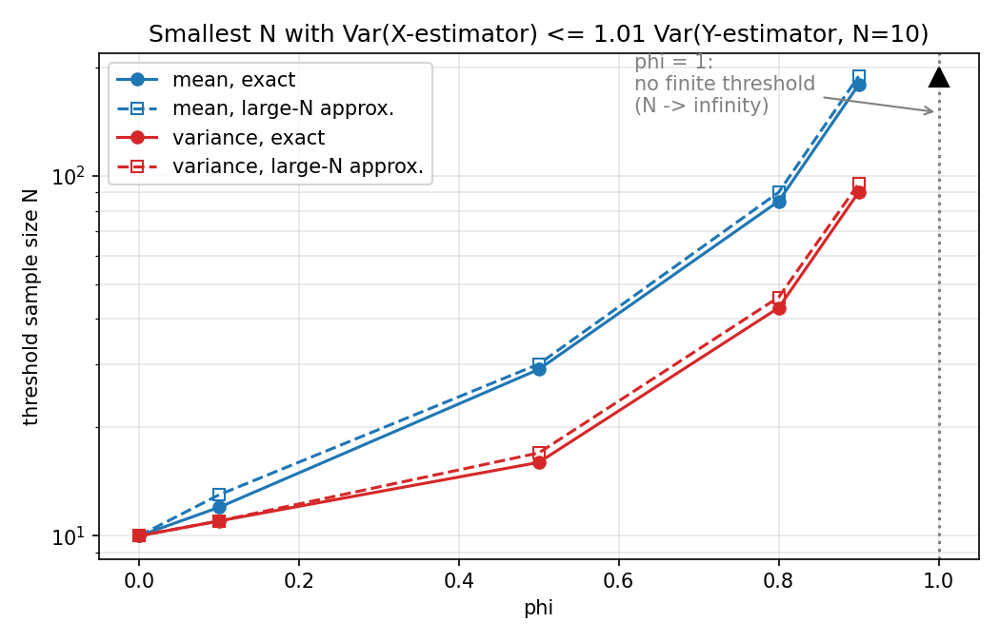
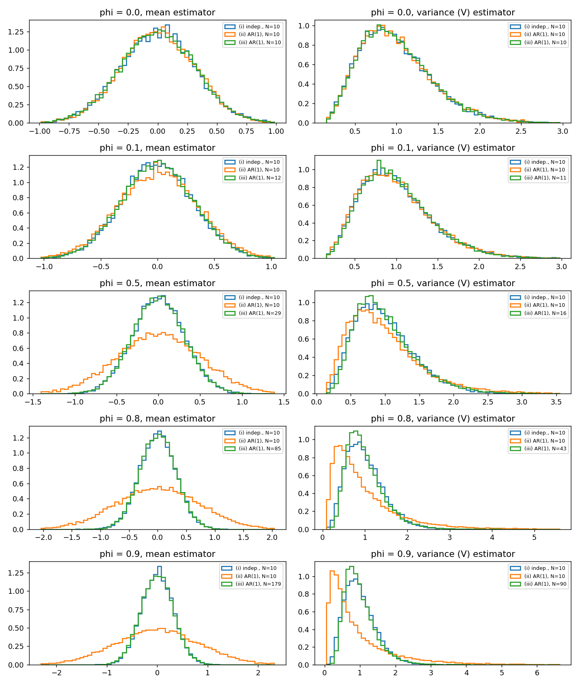

# Objective Analysis Week 07 Homework — 完整解答

題目見 [Week07.pdf](Week07.pdf)。

---

## Question 1. DDPM: Deriving the Reverse Posterior

### 中文翻譯

> 考慮純量前向擴散過程 $x_t = \sqrt{\alpha_t}\,x_{t-1} + \sqrt{\beta_t}\,z_t$，$z_t \overset{\text{iid}}{\sim} \mathcal{N}(0,1)$，其中 $0 < \beta_t < 1$、$\alpha_t = 1 - \beta_t$、$\bar\alpha_t = \prod_{s=1}^t \alpha_s$。每個 $z_t$ 與 $x_0, z_1, \dots, z_{t-1}$ 獨立。對 $t \ge 2$ 可使用 $q(x_{t-1} \mid x_0) = \mathcal{N}(x_{t-1};\ \sqrt{\bar\alpha_{t-1}}\,x_0,\ 1 - \bar\alpha_{t-1})$。
>
> * (a) **後驗分布**：用貝氏定理並對 $x_{t-1}$ 配方，證明 $q(x_{t-1} \mid x_t, x_0) = \mathcal{N}(x_{t-1}; \tilde\mu_t, \tilde\beta_t)$，以 $x_t, x_0, \alpha_t, \beta_t, \bar\alpha_{t-1}$ 寫出 $\tilde\mu_t$ 與 $\tilde\beta_t$，並在推導中寫出二次項與一次項係數。
> * (b) **雜訊參數化**：利用 $x_t = \sqrt{\bar\alpha_t}\,x_0 + \sqrt{1 - \bar\alpha_t}\,\varepsilon$ 消去 $x_0$，證明 $\tilde\mu_t = \frac{1}{\sqrt{\alpha_t}}\big(x_t - \frac{\beta_t}{\sqrt{1 - \bar\alpha_t}}\varepsilon\big)$。說明 $\varepsilon$ 與單步雜訊 $z_t$ 有何不同。
> * (c) **學習反向過程**：生成時無法取得 $x_0$ 與實際的前向雜訊。神經網路 $\varepsilon_\theta(x_t, t)$ 預測累積雜訊。寫出反向均值 $\mu_\theta(x_t, t)$ 與常用的簡化均方誤差訓練目標。解釋為何訓練時知道精確後驗，仍不能免去學習反向模型的需要。

## Answer 1.

### (a) 後驗分布

* **貝氏定理**

  因為前向過程是馬可夫鏈，給定 $x_{t-1}$ 之後 $x_t$ 與 $x_0$ 無關，即 $q(x_t \mid x_{t-1}, x_0) = q(x_t \mid x_{t-1})$。所以

  $$q(x_{t-1} \mid x_t, x_0) = \frac{q(x_t \mid x_{t-1})\,q(x_{t-1} \mid x_0)}{q(x_t \mid x_0)} \;\propto\; q(x_t \mid x_{t-1})\,q(x_{t-1} \mid x_0)$$

  分母 $q(x_t \mid x_0)$ 不含 $x_{t-1}$，只是歸一化常數。其中

  $$q(x_t \mid x_{t-1}) = \mathcal{N}\big(x_t;\ \sqrt{\alpha_t}\,x_{t-1},\ \beta_t\big), \qquad q(x_{t-1} \mid x_0) = \mathcal{N}\big(x_{t-1};\ \sqrt{\bar\alpha_{t-1}}\,x_0,\ 1 - \bar\alpha_{t-1}\big)$$

* **展開指數並整理成 $x_{t-1}$ 的二次式**

  $$\log q(x_{t-1} \mid x_t, x_0) = -\frac12\left[\frac{(x_t - \sqrt{\alpha_t}\,x_{t-1})^2}{\beta_t} + \frac{(x_{t-1} - \sqrt{\bar\alpha_{t-1}}\,x_0)^2}{1 - \bar\alpha_{t-1}}\right] + \text{const}$$

  $$= -\frac12\Big[a\,x_{t-1}^2 - 2b\,x_{t-1}\Big] + \text{const}$$

  **二次項係數：**

  $$a = \frac{\alpha_t}{\beta_t} + \frac{1}{1 - \bar\alpha_{t-1}} = \frac{\alpha_t(1 - \bar\alpha_{t-1}) + \beta_t}{\beta_t(1 - \bar\alpha_{t-1})} = \frac{1 - \alpha_t\bar\alpha_{t-1}}{\beta_t(1 - \bar\alpha_{t-1})}$$

  （分子用到 $\alpha_t + \beta_t = 1$：$\alpha_t - \alpha_t\bar\alpha_{t-1} + \beta_t = 1 - \alpha_t\bar\alpha_{t-1} = 1 - \bar\alpha_t$。）

  **一次項係數：**

  $$b = \frac{\sqrt{\alpha_t}\,x_t}{\beta_t} + \frac{\sqrt{\bar\alpha_{t-1}}\,x_0}{1 - \bar\alpha_{t-1}}$$

* **配方**

  $$a\,x_{t-1}^2 - 2b\,x_{t-1} = a\left(x_{t-1} - \frac{b}{a}\right)^2 - \frac{b^2}{a}$$

  所以後驗是高斯分布，變異數為 $1/a$，均值為 $b/a$：

  $$\boxed{\tilde\beta_t = \frac{1}{a} = \frac{(1 - \bar\alpha_{t-1})\,\beta_t}{1 - \alpha_t\bar\alpha_{t-1}}}$$

  $$\boxed{\tilde\mu_t = \frac{b}{a} = \frac{\sqrt{\alpha_t}\,(1 - \bar\alpha_{t-1})}{1 - \alpha_t\bar\alpha_{t-1}}\,x_t + \frac{\sqrt{\bar\alpha_{t-1}}\,\beta_t}{1 - \alpha_t\bar\alpha_{t-1}}\,x_0}$$

  其中 $1 - \alpha_t\bar\alpha_{t-1} = 1 - \bar\alpha_t$。均值是 $x_t$ 與 $x_0$ 的加權組合。後驗變異數 $\tilde\beta_t < \beta_t$，因為多知道了 $x_0$，不確定性變小。

### (b) 雜訊參數化

* **消去 $x_0$**

  由 $x_t = \sqrt{\bar\alpha_t}\,x_0 + \sqrt{1 - \bar\alpha_t}\,\varepsilon$ 解出 $x_0 = \frac{1}{\sqrt{\bar\alpha_t}}\big(x_t - \sqrt{1 - \bar\alpha_t}\,\varepsilon\big)$，代入 $\tilde\mu_t$ 的第二項。利用 $\sqrt{\bar\alpha_{t-1}}/\sqrt{\bar\alpha_t} = 1/\sqrt{\alpha_t}$：

  $$\frac{\sqrt{\bar\alpha_{t-1}}\,\beta_t}{1 - \bar\alpha_t}\,x_0 = \frac{\beta_t}{\sqrt{\alpha_t}\,(1 - \bar\alpha_t)}\big(x_t - \sqrt{1 - \bar\alpha_t}\,\varepsilon\big)$$

  合併 $x_t$ 的係數：

  $$\frac{\sqrt{\alpha_t}(1 - \bar\alpha_{t-1})}{1 - \bar\alpha_t} + \frac{\beta_t}{\sqrt{\alpha_t}(1 - \bar\alpha_t)} = \frac{\alpha_t(1 - \bar\alpha_{t-1}) + \beta_t}{\sqrt{\alpha_t}\,(1 - \bar\alpha_t)} = \frac{1 - \bar\alpha_t}{\sqrt{\alpha_t}\,(1 - \bar\alpha_t)} = \frac{1}{\sqrt{\alpha_t}}$$

  $\varepsilon$ 的係數為 $-\frac{\beta_t\sqrt{1 - \bar\alpha_t}}{\sqrt{\alpha_t}(1 - \bar\alpha_t)} = -\frac{\beta_t}{\sqrt{\alpha_t}\sqrt{1 - \bar\alpha_t}}$。因此

  $$\boxed{\tilde\mu_t = \frac{1}{\sqrt{\alpha_t}}\left(x_t - \frac{\beta_t}{\sqrt{1 - \bar\alpha_t}}\,\varepsilon\right)}$$

* **$\varepsilon$ 與 $z_t$ 的差別**

  $z_t$ 是 $t-1 \to t$ **這一步**加入的雜訊。$\varepsilon$ 則是從 $x_0$ 到 $x_t$ **累積**的全部雜訊，再標準化成 $\mathcal{N}(0,1)$：

  $$\sqrt{1 - \bar\alpha_t}\,\varepsilon = \sum_{s=1}^{t}\sqrt{\frac{\bar\alpha_t}{\bar\alpha_s}}\sqrt{\beta_s}\,z_s$$

  所以 $\varepsilon$ 是 $z_1, \dots, z_t$ 的加權組合，$z_t$ 只是其中一項。兩者相關但不相等，相關係數為 $\mathrm{Corr}(\varepsilon, z_t) = \sqrt{\beta_t / (1 - \bar\alpha_t)}$，只有在 $t = 1$ 時才等於 1。

### (c) 學習反向過程

* **反向均值**

  生成時不知道真正的 $\varepsilon$，所以用網路的預測 $\varepsilon_\theta(x_t, t)$ 取代 (b) 式中的 $\varepsilon$：

  $$\boxed{\mu_\theta(x_t, t) = \frac{1}{\sqrt{\alpha_t}}\left(x_t - \frac{\beta_t}{\sqrt{1 - \bar\alpha_t}}\,\varepsilon_\theta(x_t, t)\right)}$$

* **簡化的訓練目標**

  $$\boxed{L_{\text{simple}}(\theta) = \mathbb{E}_{x_0 \sim q_{\text{data}},\ t \sim \mathrm{U}\{1,\dots,T\},\ \varepsilon \sim \mathcal{N}(0,1)}\Big[\big(\varepsilon - \varepsilon_\theta\big(\sqrt{\bar\alpha_t}\,x_0 + \sqrt{1 - \bar\alpha_t}\,\varepsilon,\ t\big)\big)^2\Big]}$$

  由 (b) 可知 $\tilde\mu_t - \mu_\theta = \frac{\beta_t}{\sqrt{\alpha_t}\sqrt{1 - \bar\alpha_t}}(\varepsilon_\theta - \varepsilon)$。所以讓 $\varepsilon_\theta$ 逼近 $\varepsilon$，就等於讓 $\mu_\theta$ 逼近真實後驗均值 $\tilde\mu_t$。「簡化」指的是把每個 $t$ 前面的權重 $\frac{\beta_t^2}{2\sigma_t^2\alpha_t(1 - \bar\alpha_t)}$ 拿掉。

* **為什麼知道精確後驗，仍需要學習反向模型？**

  精確後驗 $q(x_{t-1} \mid x_t, x_0)$ 需要以 $x_0$（或等價的 $\varepsilon$）為條件。訓練時我們自己產生了 $x_0$ 和 $\varepsilon$，所以它可以算出來，當作監督的目標。但生成時的目的正是要產生一個新的 $x_0$，所以手上只有 $x_t$。

  生成真正需要的是 $q(x_{t-1} \mid x_t) = \int q(x_{t-1} \mid x_t, x_0)\,q(x_0 \mid x_t)\,dx_0$。這個積分需要知道「看到 $x_t$ 之後，$x_0$ 可能是什麼」的分布 $q(x_0 \mid x_t)$，而它又取決於未知的資料分布，所以無法直接計算。網路 $\varepsilon_\theta(x_t, t)$ 的作用就是從資料中學會 $\mathbb{E}[\varepsilon \mid x_t]$：均方誤差的最小化解就是條件期望。精確後驗在訓練時提供目標，但它無法取代那個只看 $x_t$ 的反向模型。

---

## Question 2. AR(1): Effective Sample Size

### 中文翻譯

> 令 $Y_1, \dots, Y_{10}$ 為來自 $\mathcal{N}(0,1)$ 的獨立樣本，與高斯 AR(1) 過程 $X_n = \phi X_{n-1} + \sqrt{1 - \phi^2}\,Z_n$（$Z_n \overset{\text{iid}}{\sim} \mathcal{N}(0,1)$，$0 \le \phi \le 1$）的 $N$ 筆連續觀測比較。初始化 $X_0 \sim \mathcal{N}(0,1)$，與所有創新項獨立。於是 $X_n \sim \mathcal{N}(0,1)$，$\mathrm{Cov}(X_i, X_j) = \phi^{|i-j|}$。定義 $\bar X_N = \frac1N\sum X_i$、$V_{X,N} = \frac1N\sum X_i^2$（母體平均已知為 0，不減去樣本平均），$\bar Y_{10}$、$V_{Y,10}$ 同理。
>
> * (a) **抽樣不確定性**：推導 $\bar X_N$ 與 $V_{X,N}$ 的精確有限 $N$ 變異數，以及獨立參考的對應變異數。可用 $\mathrm{Cov}(U^2, W^2) = 2[\mathrm{Cov}(U, W)]^2$。藉由與獨立觀測的變異數比對，推導平均的有效樣本數與變異數估計量的有效自由度。
> * (b) **所需樣本數**：對 $\phi \in \{0, 0.1, 0.5, 0.8, 0.9, 1.0\}$，分別對平均與變異數估計量，找最小整數 $N \ge 10$ 使 $\mathrm{Var}(\hat\theta_{X,N}) \le 1.01\,\mathrm{Var}(\hat\theta_{Y,10})$。畫出兩種門檻樣本數對 $\phi$ 的圖，並與「自相關和延伸到無窮」的大 $N$ 近似比較。不可限制 $N \le 120$。若不存在有限門檻，說明原因並在圖上標示。
> * (c) **Monte Carlo 比較**：對每個有有限門檻的 $\phi$，用至少 20,000 次獨立重複，比較各估計量在 (i) 10 筆獨立觀測、(ii) 10 筆連續 AR(1) 觀測、(iii) (b) 的門檻樣本數下的抽樣分布。在每組比較中用相同 bins 畫歸一化直方圖，並報告模擬的期望值與變異數。門檻用理論決定。解釋為何平均與變異數估計量需要不同樣本數，以及為何相近的抽樣變異數一般不代表相同的抽樣分布。對 $\phi = 1$，描述此過程並說明增加 $N$ 是否能降低任一估計量的不確定性。

## Answer 2.

程式：[hw7_q2.py](hw7_q2.py)（執行：在 hw7 資料夾輸入 `py hw7_q2.py`），亂數種子 `SEED = 2026`，Monte Carlo 重複次數 $M = 20000$。

### (a) 抽樣不確定性

* **獨立參考**

  $Y_i$ 獨立且 $\mathrm{Var}(Y_i) = 1$、$\mathrm{Var}(Y_i^2) = \mathbb{E}[Y^4] - 1 = 2$，所以

  $$\mathrm{Var}(\bar Y_{10}) = \frac{1}{10}, \qquad \mathrm{Var}(V_{Y,10}) = \frac{2}{10}$$

  一般而言，$N$ 筆獨立樣本給出 $\mathrm{Var}(\bar Y_N) = 1/N$，$\mathrm{Var}(V_{Y,N}) = 2/N$（因為 $N V_{Y,N} \sim \chi^2_N$）。

* **AR(1) 平均的變異數**

  $$\mathrm{Var}(\bar X_N) = \frac{1}{N^2}\sum_{i=1}^N\sum_{j=1}^N \phi^{|i-j|} = \frac{1}{N}\left[1 + 2\sum_{k=1}^{N-1}\left(1 - \frac{k}{N}\right)\phi^k\right]$$

  第二個等號是因為時間差為 $k$ 的 $(i,j)$ 配對有 $2(N-k)$ 個。

* **AR(1) 變異數估計量的變異數**

  由提示 $\mathrm{Cov}(X_i^2, X_j^2) = 2\phi^{2|i-j|}$：

  $$\mathrm{Var}(V_{X,N}) = \frac{1}{N^2}\sum_{i,j} 2\phi^{2|i-j|} = \frac{2}{N}\left[1 + 2\sum_{k=1}^{N-1}\left(1 - \frac{k}{N}\right)\phi^{2k}\right]$$

  兩者的差別只在於自相關從 $\phi^k$ 變成 $\phi^{2k}$。

* **封閉形式**

  記 $S_N(\rho) = \sum_{k=1}^{N-1}\left(1 - \frac kN\right)\rho^k = \dfrac{\rho}{1 - \rho} - \dfrac{\rho\,(1 - \rho^N)}{N(1 - \rho)^2}$（$\rho < 1$），則

  $$\mathrm{Var}(\bar X_N) = \frac{1 + 2S_N(\phi)}{N}, \qquad \mathrm{Var}(V_{X,N}) = \frac{2\,[1 + 2S_N(\phi^2)]}{N}$$

* **有效樣本數與有效自由度**

  把 AR(1) 的變異數寫成「等效的獨立樣本數」：令 $\mathrm{Var}(\bar X_N) = 1/N_{\text{eff}}$、$\mathrm{Var}(V_{X,N}) = 2/\nu_{\text{eff}}$，得到

  $$\boxed{N_{\text{eff}} = \frac{N}{1 + 2S_N(\phi)} \;\xrightarrow{N \gg 1}\; N\,\frac{1 - \phi}{1 + \phi}}, \qquad \boxed{\nu_{\text{eff}} = \frac{N}{1 + 2S_N(\phi^2)} \;\xrightarrow{N \gg 1}\; N\,\frac{1 - \phi^2}{1 + \phi^2}}$$

  $N = 10$ 時的數值：

  | $\phi$ | $\mathrm{Var}(\bar X_{10})$ | $N_{\text{eff}}$ | $\mathrm{Var}(V_{X,10})$ | $\nu_{\text{eff}}$ |
  | --- | --- | --- | --- | --- |
  | 0.0 | 0.1000 | 10.00 | 0.2000 | 10.00 |
  | 0.1 | 0.1198 | 8.35 | 0.2036 | 9.82 |
  | 0.5 | 0.2600 | 3.85 | 0.3156 | 6.34 |
  | 0.8 | 0.5429 | 1.84 | 0.7159 | 2.79 |
  | 0.9 | 0.7276 | 1.37 | 1.1169 | 1.79 |
  | 1.0 | 1.0000 | 1.00 | 2.0000 | 1.00 |

### (b) 所需樣本數

* **判準與大 $N$ 近似**

  平均：$\mathrm{Var}(\bar X_N) \le 1.01 \times 0.1$；變異數：$\mathrm{Var}(V_{X,N}) \le 1.01 \times 0.2$。

  把自相關和延伸到無窮（$S_N(\rho) \to \rho/(1-\rho)$），得到 $\mathrm{Var}(\bar X_N) \approx \frac{1}{N}\frac{1+\phi}{1-\phi}$、$\mathrm{Var}(V_{X,N}) \approx \frac{2}{N}\frac{1+\phi^2}{1-\phi^2}$，於是近似門檻為

  $$N_{\text{mean}}^{\infty} = \left\lceil \frac{10}{1.01}\cdot\frac{1+\phi}{1-\phi} \right\rceil, \qquad N_{\text{var}}^{\infty} = \left\lceil \frac{10}{1.01}\cdot\frac{1+\phi^2}{1-\phi^2} \right\rceil$$

  （兩者都至少取 10。）精確門檻用 (a) 的有限 $N$ 公式，從 $N = 10$ 往上逐一搜尋，不設上限。

* **結果**

  | $\phi$ | 平均：精確 $N$ | 平均：大 $N$ 近似 | 變異數：精確 $N$ | 變異數：大 $N$ 近似 |
  | --- | --- | --- | --- | --- |
  | 0.0 | 10 | 10 | 10 | 10 |
  | 0.1 | 12 | 13 | 11 | 11 |
  | 0.5 | 29 | 30 | 16 | 17 |
  | 0.8 | 85 | 90 | 43 | 46 |
  | 0.9 | 179 | 189 | 90 | 95 |
  | 1.0 | 不存在（$\infty$） | 不存在 | 不存在（$\infty$） | 不存在 |

  

* **與大 $N$ 近似的比較**

  大 $N$ 近似總是**高估**門檻。原因是精確公式多了一個負的修正項 $-\frac{\rho(1 - \rho^N)}{N(1-\rho)^2}$，這一項來自「時間差 $k$ 的配對只有 $N - k$ 個」的邊界效應，它讓有限 $N$ 的變異數比近似值小。$\phi$ 越大，這個修正項越大，兩者差距也越大（$\phi = 0.9$ 時差 10 個樣本），但相對差距只有約 5%。

* **$\phi = 1$ 沒有有限門檻**

  $\phi = 1$ 時 $\sqrt{1 - \phi^2} = 0$，過程變成 $X_n = X_{n-1} = \dots = X_0$，所有觀測都是同一個值。此時 $\bar X_N = X_0$、$V_{X,N} = X_0^2$，所以對任何 $N$ 都有

  $$\mathrm{Var}(\bar X_N) = 1 > 0.101, \qquad \mathrm{Var}(V_{X,N}) = 2 > 0.202$$

  變異數完全不隨 $N$ 下降，所以不存在有限門檻。圖上以 $\phi = 1$ 的虛線與標註表示 $N \to \infty$。

### (c) Monte Carlo 比較

每一格內三條直方圖使用相同的 bins，縱軸為歸一化密度。

* **模擬的期望值與變異數**

  **平均估計量**（理論期望值為 0）：

  | $\phi$ | (i) 獨立 $N=10$：E / Var | (ii) AR(1) $N=10$：E / Var（理論） | (iii) AR(1) 門檻 $N$：E / Var（理論） |
  | --- | --- | --- | --- |
  | 0.0 | +0.0011 / 0.1003 | +0.0003 / 0.1001 (0.1000) | $N=10$：−0.0018 / 0.1003 (0.1000) |
  | 0.1 | −0.0007 / 0.1002 | +0.0022 / 0.1230 (0.1198) | $N=12$：−0.0001 / 0.1021 (0.1001) |
  | 0.5 | +0.0021 / 0.0985 | +0.0030 / 0.2588 (0.2600) | $N=29$：−0.0018 / 0.0989 (0.0987) |
  | 0.8 | +0.0017 / 0.0998 | +0.0017 / 0.5399 (0.5429) | $N=85$：+0.0025 / 0.0996 (0.1004) |
  | 0.9 | +0.0035 / 0.0995 | +0.0049 / 0.7098 (0.7276) | $N=179$：−0.0036 / 0.1026 (0.1005) |

  **變異數估計量**（理論期望值為 1）：

  | $\phi$ | (i) 獨立 $N=10$：E / Var / 偏度 | (ii) AR(1) $N=10$：E / Var（理論）/ 偏度 | (iii) AR(1) 門檻 $N$：E / Var（理論）/ 偏度 |
  | --- | --- | --- | --- |
  | 0.0 | 0.997 / 0.1998 / 0.89 | 1.002 / 0.2007 (0.2000) / 0.90 | $N=10$：1.001 / 0.1949 (0.2000) / 0.84 |
  | 0.1 | 1.003 / 0.1989 / 0.90 | 1.004 / 0.2063 (0.2036) / 0.95 | $N=11$：1.003 / 0.1848 (0.1852) / 0.84 |
  | 0.5 | 0.993 / 0.1976 / 0.89 | 0.997 / 0.3175 (0.3156) / 1.55 | $N=16$：1.006 / 0.2071 (0.2014) / 1.18 |
  | 0.8 | 1.000 / 0.2017 / 0.90 | 0.996 / 0.7188 (0.7159) / 2.43 | $N=43$：1.003 / 0.2026 (0.2012) / 1.29 |
  | 0.9 | 0.997 / 0.1994 / 0.89 | 0.984 / 1.0806 (1.1169) / 2.71 | $N=90$：0.996 / 0.1994 (0.2006) / 1.38 |

  兩個估計量在三種情況下都是**不偏**的（模擬平均分別接近 0 和 1），模擬變異數也和理論值吻合到抽樣誤差以內。在 (ii) 中，相關性讓變異數大幅膨脹；到 (iii)，變異數回到獨立參考的水準。

* **為什麼平均與變異數估計量需要不同的樣本數？**

  平均估計量的有效性取決於 $X_i$ 之間的相關 $\phi^{k}$，而變異數估計量取決於 $X_i^2$ 之間的相關 $\mathrm{Corr}(X_i^2, X_j^2) = \phi^{2k}$。因為 $0 < \phi < 1$ 時 $\phi^2 < \phi$，平方之後的序列「記憶」衰減得快一倍，相鄰觀測之間的重複資訊較少。變異數膨脹因子 $\frac{1+\phi^2}{1-\phi^2}$ 因此小於平均的 $\frac{1+\phi}{1-\phi}$（$\phi = 0.9$ 時分別是 9.5 和 19）。所以變異數估計量只需要約一半的樣本數。

* **為什麼相近的抽樣變異數不代表相同的抽樣分布？**

  對平均估計量而言，$\bar X_N$ 是高斯變數的線性組合，所以一定是高斯分布，而高斯分布完全由均值與變異數決定。因此一旦變異數相等，(i) 和 (iii) 的分布就幾乎完全重合，直方圖也證實了這一點。

  變異數估計量則不同。$V_{Y,10} = \chi^2_{10}/10$，但相關樣本的 $V_{X,N}$ 可寫成 $\frac{1}{N}\sum_j \lambda_j\,\chi^2_{1,j}$，其中 $\lambda_j$ 是相關矩陣 $[\phi^{|i-j|}]$ 的特徵值。權重不相等的卡方加權和，分布形狀不是 $\chi^2$。它的偏度為 $2\sqrt2\,\sum\lambda_j^3 / (\sum\lambda_j^2)^{3/2}$，理論值在 $\phi = 0.9$、$N = 90$ 時為 1.33，而獨立參考為 $\sqrt{8/10} = 0.89$，模擬值 1.38 與 0.89 也吻合。所以兩者即使均值與變異數都相同，(iii) 仍然更右偏：峰值更尖、更靠左，右尾更長。用到高階動差或分位數的推論（例如信賴區間）就不能只看變異數。

* **$\phi = 1$ 的情況**

  此時 $X_n = X_0$ 對所有 $n$ 成立，整條序列是一個常數，值由 $X_0 \sim \mathcal{N}(0,1)$ 隨機決定。每一筆新觀測都只是重複同一個數，完全不帶新資訊（$N_{\text{eff}} = \nu_{\text{eff}} = 1$）。

  因此 $\bar X_N = X_0 \sim \mathcal{N}(0,1)$、$V_{X,N} = X_0^2 \sim \chi^2_1$，對任何 $N$ 都有 $\mathrm{Var}(\bar X_N) = 1$、$\mathrm{Var}(V_{X,N}) = 2$。**增加 $N$ 不會降低任一估計量的不確定性。** 這個過程雖然平穩（每個 $X_n$ 都是 $\mathcal{N}(0,1)$），但不具遍歷性（ergodicity）：時間平均不會收斂到母體平均，所以單一條實現無論多長，都無法估計母體的統計量。這也是 (b) 中不存在有限門檻、(c) 中不對 $\phi = 1$ 做 Monte Carlo 比較的原因。
