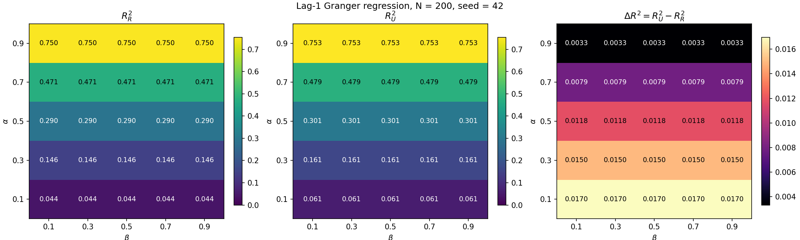

# Objective Analysis Week 08 Homework — 解答

題目見 [Week08.pdf](Week08.pdf)；Q2(b) 程式 [hw8_q2.py](hw8_q2.py)，圖 [q2_heatmaps.png](q2_heatmaps.png)。

---

## Question 1

### (a) Collinearity

* Case 1（$r_{1,2}=0$）：$R^2 = 0.36+0.16 = \mathbf{0.52}$
* Case 2（$r_{1,2}=0.5$）：$R^2 = \dfrac{0.36+0.16-2(0.6)(0.4)(0.5)}{1-0.25} = \dfrac{0.28}{0.75} \approx \mathbf{0.373}$

單用 $x_1$ 時 $R^2=0.36$。Case 1 的增量是 0.16，Case 2 只有 0.013。原因是 Case 2 中 $x_2$ 跟 $y$ 的相關有一大部分是透過 $x_1$ 間接產生的：$r_{1,y}r_{1,2}=0.3$。真正的新資訊只剩 $r_{2,y}-r_{1,y}r_{1,2}=0.1$。

### (b) 有用預報子的門檻

$$
R^2-r_{1,y}^2=\frac{r_{1,y}^2+r_{2,y}^2-2r_{1,y}r_{2,y}r_{1,2}-r_{1,y}^2(1-r_{1,2}^2)}{1-r_{1,2}^2}
=\frac{r_{2,y}^2-2r_{2,y}(r_{1,y}r_{1,2})+(r_{1,y}r_{1,2})^2}{1-r_{1,2}^2}
$$

$$
\boxed{R^2-r_{1,y}^2=\frac{(r_{2,y}-r_{1,y}r_{1,2})^2}{1-r_{1,2}^2}\ \ge 0}
$$

分母 $1-r_{1,2}^2>0$。若 $|r_{2,y}|>|r_{1,y}r_{1,2}|$，由反三角不等式 $|r_{2,y}-r_{1,y}r_{1,2}|\ge|r_{2,y}|-|r_{1,y}r_{1,2}|>0$，因此 $R^2>r_{1,y}^2$。$\blacksquare$

$r_{1,y}r_{1,2}$ 是「$x_2$ 只透過 $x_1$ 間接跟 $y$ 產生的相關」，$r_{2,y}-r_{1,y}r_{1,2}$ 則是 $x_2$ 的新資訊。

**註**：精確的充要條件是 $r_{2,y}\ne r_{1,y}r_{1,2}$，所以題目的條件是充分條件，不是必要條件。反例：$r_{1,y}=0.6$、$r_{1,2}=0.5$、$r_{2,y}=0$ 時，$R^2=0.48>0.36$（suppressor variable）。題目的條件可以理解為：$r_{2,y}$ 與 $r_{1,y}r_{1,2}$ 同號時，標準化係數 $a_2=(r_{2,y}-r_{1,y}r_{1,2})/(1-r_{1,2}^2)$ 與 $r_{2,y}$ 同號。

### (c) Overfitting

**Raw $R^2$ 會增加**，至少不會減少。

* OLS 的大模型可以令新加入的係數為 0、退回原模型，所以殘差平方和不會變大，$R^2$ 單調不減。
* 白噪音的母體相關為 0，但樣本相關約 $\sim\mathcal N(0,1/N)$，不會剛好是 0。由 (b)，每加一個噪音，$\Delta R^2$ 幾乎一定大於 0。
* 若 $N\le 103$，未知數不少於資料點，$R^2=1$（完美擬合）。

這是在擬合雜訊。應改用 adjusted $R^2$ 或 cross-validation 來判斷預報子是否有用。

---

## Question 2

### (a) 母體結果

* $\text{Var}(y_t)=\alpha^2\text{Var}(y_{t-1})+(1-\alpha^2)$，且 $\text{Var}(y_1)=1$，由歸納法得 $\text{Var}(y_t)=1$，$E[y_t]=0$；$\text{Cov}(y_t,y_{t-1})=\alpha$
* $\text{Var}(x_t)=\beta^2+1$
* $\text{Corr}(x_t,y_t)=\dfrac{\beta}{\sqrt{1+\beta^2}}$；$\text{Corr}(x_{t-1},y_t)=\dfrac{\beta\,\text{Cov}(y_{t-1},y_t)}{\sqrt{1+\beta^2}}=\dfrac{\alpha\beta}{\sqrt{1+\beta^2}}$（$\eta_{t-1}$ 與 $y_t$ 獨立）

**Restricted**：$a=\alpha$，$c_R=0$，$R_R^2=\alpha^2$

**Unrestricted**：正規方程為

$$
\begin{pmatrix}1&\beta\\\beta&1+\beta^2\end{pmatrix}\begin{pmatrix}\tilde a\\d\end{pmatrix}=\begin{pmatrix}\alpha\\\alpha\beta\end{pmatrix}
$$

係數矩陣的行列式為 1，解得 $\tilde a=(1+\beta^2)\alpha-\beta\cdot\alpha\beta=\alpha$，$d=-\beta\alpha+\alpha\beta=0$，$c_U=0$，$R_U^2=\alpha^2$。

也可以直接套 Q1：令 $x_1\to y_{t-1}$、$x_2\to x_{t-1}$，則 $r_{1,y}r_{1,2}=\alpha\cdot\frac{\beta}{\sqrt{1+\beta^2}}=r_{2,y}$，所以 $\Delta R^2=0$。

**結論：不會。** 落後相關不為 0，但它完全來自 $x_{t-1}=\beta y_{t-1}+\eta_{t-1}$ 中的 $y_{t-1}$ 成分，restricted 模型已經包含這部分資訊。控制 $y_{t-1}$ 之後 $d=0$，$x$ 不 Granger-cause $y$；實際的因果方向是 $y\to x$。

### (b) 數值實驗（$N=200$，seed 42）

| $\alpha$ | $\alpha^2$ | $R^2_R$ | $R^2_U$ | $\Delta R^2$ |
|---|---|---|---|---|
| 0.1 | 0.01 | 0.044 | 0.061 | 0.0170 |
| 0.3 | 0.09 | 0.146 | 0.161 | 0.0150 |
| 0.5 | 0.25 | 0.290 | 0.301 | 0.0118 |
| 0.7 | 0.49 | 0.471 | 0.479 | 0.0079 |
| 0.9 | 0.81 | 0.750 | 0.753 | 0.0033 |

三個量沿 $\beta$ 方向完全不變：$R^2_U$ 沿 $\beta$ 的最大差異為 $2.2\times10^{-16}$。

### (c) 解讀

* **$R^2_U\ge R^2_R$**：restricted 模型是 unrestricted 模型在 $d=0$ 時的特例（巢狀模型）。OLS 在較大的參數空間中最小化殘差平方和，結果不會比較差，所以樣本 $R^2$ 只增不減。但 (a) 已證明母體的 $d=0$、$R_U^2=R_R^2$。觀察到的 $\Delta R^2\approx0.003$–$0.017$ 只是 $\eta_{t-1}$ 和 $y_t$ 之間不為 0 的樣本相關，量級約 $(1-R^2_R)/(N-3)\sim O(1/N)$，屬於抽樣雜訊。要判斷 Granger causality，必須對 $H_0:d=0$ 做 F-test 或 t-test，而不是只看 $\Delta R^2>0$。
* **$R^2_U$ 不隨 $\beta$ 改變**：$x_{t-1}=\beta y_{t-1}+\eta_{t-1}$。當 $\beta>0$ 時，
  $$\text{span}\{1,\,y_{t-1},\,x_{t-1}\}=\text{span}\{1,\,y_{t-1},\,\eta_{t-1}\}$$
  與 $\beta$ 無關。OLS 的擬合值是 $y_t$ 在這個子空間上的正交投影，所以投影結果、殘差和 $R^2_U$ 都跟 $\beta$ 無關，改變的只有係數：$d=d_\eta$、$\tilde a=a_\eta-\beta d_\eta$。同一個 $\alpha$ 下 $y$ 和 $\eta$ 的實現值相同，所以 $R^2_U$ 只差到機器精度。$R^2_R$ 本來就不含 $x$，同樣跟 $\beta$ 無關。
